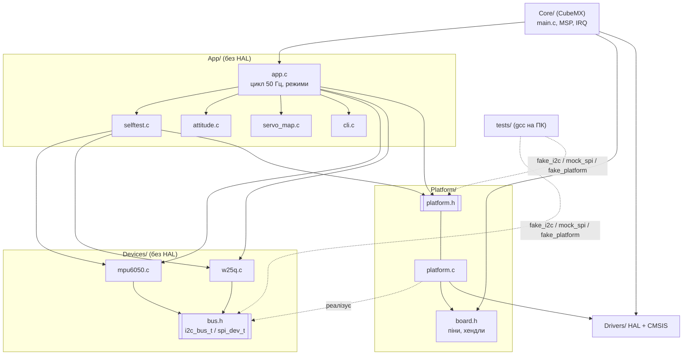

# Архітектура прошивки — ЛР2

## 1. Шари

```
firmware/
├── Core/       згенерований CubeMX код: main(), MX_*_Init(), MSP, IRQ, syscalls
├── Drivers/    CMSIS + STM32C0 HAL v1.4.1 від ST — НЕ редагуються (VERSIONS.md)
├── Platform/   адаптація до плати: board.h (піни, хендли), platform.c (порт для App,
│               реалізації шин I2C/SPI над HAL + bit-bang I2C)
├── Devices/    bus.h (інтерфейс шин) + драйвери mpu6050.c, w25q.c — без HAL
└── App/        app.c (головний цикл), selftest.c, attitude.c, servo_map.c, cli.c — без HAL
chips/          модель W25Q64 для Wokwi (C -> wasm)
tests/          хостові тести (gcc + Unity): doubles/ (fake/mock/stub), test_*.c
tools/          check_deps.py, check_pinout.py, la_analyze.py, extract_vectors.py, make_report.py
```

| Шар | Знає про | Не знає про | Чому |
|---|---|---|---|
| **Core** | HAL, board.h, `app_main()` | драйвери, логіку | CubeMX перегенеровує його з `.ioc`; власний код лише в `USER CODE` (2 рядки: старт PWM і `app_main()`) |
| **Platform** | HAL, board.h, `bus.h`, `platform.h` | App | Єдине місце, де HAL зустрічається з рештою коду; при переході на F446 змінюється лише цей шар |
| **Devices** | `bus.h`, libc | HAL, Platform, App | Драйвер = чистий C над інтерфейсом шини, тож його можна тестувати на ПК і перенести на інший МК без змін |
| **App** | `platform.h`, Devices, libc | HAL, board.h | Бізнес-логіка продукту (режими, кути, серво, self-test) не залежить від плати |

Component diagram (обов'язкова, lab-report-format §2.7): `docs/lab_2/img/component-diagram.png`
(генерується `tools/make_diagrams.py`).



## 2. Правило залежностей і його автоматична перевірка

Дозволено (стрілка = `#include`):

| Хто \ кого | Core | Platform | Devices | App | HAL | libc |
|---|---|---|---|---|---|---|
| Core | ✔ | ✔ | — | лише `app.h` | ✔ | ✔ |
| Platform | — | ✔ | лише `bus.h` | — | ✔ | ✔ |
| Devices | — | — | ✔ | — | — | ✔ |
| App | — | лише `platform.h` | ✔ | ✔ | — | ✔ |

Перевірку робить не людина, а `tools/check_deps.py`: він розбирає кожен `#include` у `firmware/{Core,Platform,Devices,App}`
і визначає шар заголовка за каталогом, а HAL — за префіксом `stm32*`, `core_cm*`, `cmsis_*`. На порушенні
скрипт повертає код 1. Скрипт запускається в `make check` і в CI на кожен pull request. Негативний тест
(додати `#include "stm32c0xx_hal.h"` у `App/servo_map.c`) дає:

```
DEPS ERROR App/servo_map.c:1: App -> HAL (stm32c0xx_hal.h) заборонено
check_deps: 74 #include перевірено, порушень: 1
```

Друга лінія захисту — збірка тестів. `tests/Makefile` не додає жодного `-I` на HAL, тож модуль App/Devices,
що включив HAL, просто не скомпілюється на ПК.

## 3. Як драйвер отримує доступ до шини

`Devices/bus.h` визначає дві структури з вказівниками на функції і контекстом:

```c
typedef struct { int (*write)(void*, uint8_t a7, const uint8_t*, size_t);
                 int (*write_read)(void*, uint8_t a7, const uint8_t*, size_t, uint8_t*, size_t);
                 void *ctx; } i2c_bus_t;
typedef struct { void (*select)(void*, int); int (*transfer)(void*, const uint8_t*, uint8_t*, size_t);
                 void (*delay_us)(void*, uint32_t); void *ctx; } spi_dev_t;
```

Контекст пристрою (`mpu6050_t { const i2c_bus_t *bus; uint8_t addr; }`, `w25q_t { const spi_dev_t *spi; ... }`)
зберігає вказівник на шину. Драйвер викликає `d->bus->write_read(d->bus->ctx, ...)` і не знає про
`HAL_I2C_Mem_Read`. Той самий прийом використовують ST platform-independent drivers (`stmdev_ctx_t`).

| Реалізація | Де | Для чого |
|---|---|---|
| `plat_i2c_hw()` — HAL_I2C (I2C1) | Platform/platform.c | основна на реальній платі |
| `plat_i2c_sw()` — bit-bang PB8/PB9 | Platform/platform.c | обхід дефекту моделі Wokwi (analysis.md §A1); вибирається self-test-ом автоматично |
| `plat_flash_spi()` — HAL_SPI + GPIO CS# | Platform/platform.c | W25Q64 |
| `fake_i2c` (регістровий файл + інжекція NACK/timeout) | tests/doubles | хостові тести MPU-6050 |
| `mock_spi` (журнал CS#/байтів + черга MISO) | tests/doubles | перевірка послідовності команд W25Q64 |
| `fake_platform` (stub-и UART/ADC/серво) | tests/doubles | хостові тести self-test |

Перевага в тому, що перемикання HW ↔ bit-bang I2C у self-test зводиться до заміни одного вказівника
(`x->imu.bus = plat_i2c_sw()`), а драйвер MPU-6050 при цьому не змінюється.

## 4. Знання про плату — в одному місці

`Platform/board.h` містить усі порти, піни, AF, хендли і константи тактування периферії (PSC/ARR, I2C TIMINGR,
SPI prescaler). `Core/Src/main.c` і `stm32c0xx_hal_msp.c` беруть значення лише звідти. `main.h` номерів
пінів не дублює, бо CubeMX-мітки GPIO в `.ioc` названі інакше (`FLASH_CS`, `IMU_SCL`…).
Відповідність `board.h` ↔ `.ioc` ↔ `diagram.json` перевіряє `tools/check_pinout.py`.

### HAL-модулі (`Core/Inc/stm32c0xx_hal_conf.h`)
Увімкнено лише: ADC, CORTEX, DMA (тільки типи в хендлах), FLASH (латентність у `HAL_RCC_ClockConfig`), GPIO,
I2C, PWR (`HAL_MspInit`), RCC, SPI, TIM, UART. EXTI вимкнено, бо кнопка опитується. У Makefile модулі
перелічено явно (`HAL_USED`), а не через `wildcard`. Обґрунтування кожного модуля записано коментарем у самому `hal_conf.h`.

### Код CubeMX і повторна генерація
Власний код у `Core/` стоїть лише між `/* USER CODE BEGIN x */ … /* USER CODE END x */` (main.c: Includes, 2,
Error_Handler_Debug; main.h: Includes). Генерація з `.ioc` (ProjectManager.KeepUserCode = true) перезаписує
все поза цими секціями. Тому `MX_*_Init()` відповідають `.ioc`, а логіка винесена в App/.
Обмеження секцій такі: нові файли CubeMX не створює в Platform/Devices/App (вони поза його відома), а
змінений у `.ioc` пін автоматично потрапляє лише в `MX_GPIO_Init()`, не в `board.h`. Цю розбіжність ловить `check_pinout.py`.

## 5. Збірка, версії, CI

* `make build` — Docker-образ `stm32-build:lab2` (ubuntu 22.04; версії apt-пакетів зафіксовані в `docker/Dockerfile`).
  Власний код компілюється з `-Wall -Wextra -Werror -Wshadow -Wdouble-promotion`, вендорський HAL — з
  `-Wall -Wextra -Wno-unused-parameter`, заголовки HAL підключено через `-isystem`. Результат: **0 попереджень**.
  Оптимізація `-Os -flto` дає 26.9 КБ з 32 КБ flash (з `-Og` було 30.8 КБ, 94 %). `syscalls.c`/`sysmem.c`
  зібрано без LTO (Журнал проблем №4).
* Версії бібліотек: `firmware/Drivers/VERSIONS.md` (HAL v1.4.1, коміт 038bed9f; Unity v2.6.0, sha256).
* `make test` / `make coverage` — хостові тести (розд. 6). `make check` — шари + pinout. `make ci` — усе разом.
* `.github/workflows/ci.yml` — на кожен pull request: `make image`, `make build`, `make check`, `make coverage`;
  артефакти: ELF/HEX/MAP і HTML-звіт покриття.

## 6. Тестування

| Що тестується | Тип double | Файл |
|---|---|---|
| Перетворення сирих даних MPU-6050 у фізичні одиниці (±2 g, ±250 °/с, температура) | — / fake | test_mpu6050.c |
| Обробка помилок шини: NACK (адреса 0x69), timeout посеред init, неочікуваний WHO_AM_I | **fake** I2C з інжекцією | test_mpu6050.c |
| Приклад із datasheet: T = TEMP_OUT/340 + 36.53 (RM-MPU §4.18) | — | test_mpu6050.c |
| Вектори з логічного аналізатора: 14 байтів SDA → ті самі raw, що в UART | fake I2C | test_mpu6050.c + la_vectors.h |
| Послідовність команд SPI-flash: WREN (06h) в окремому CS# **перед** 02h/20h, перевірка WEL, опитування BUSY, адреса MSB-first, межа сторінки | **mock** SPI | test_w25q.c |
| JEDEC ID і помилки: MISO = FF/00 (немає чипа), CS# піднімається навіть при помилці шини | mock SPI | test_w25q.c |
| Прикладна логіка: кут ↔ мкс, потенціометр, мертва зона ±2°, обмеження 300 °/с, комплементарний фільтр, CLI | — | test_app_logic.c |
| Self-test: формат рядків, fallback HW → SW I2C, відсутні пристрої, CCR не записався | **stub**-платформа + fake + mock | test_selftest.c |

*Fake* — робоча спрощена реалізація зі станом (регістровий файл MPU-6050). Тест перевіряє стан (що записано
в PWR_MGMT_1). *Mock* записує **взаємодію**, і тест порівнює журнал викликів з очікуваним
(`"S 06 D S 05 FF D S 02 01 23 45 A5 5A D ..."`). Mock потрібен саме для W25Q64: важливий порядок
CS#-інтервалів, а не лише результат. *Stub* — заглушки з фіксованими відповідями (ADC = 2048, `plat_millis`).

Покриття (gcovr, `make coverage`): **99.4 % рядків, 100 % функцій, 75.7 % гілок** для Devices/ і App/ (без app.c).
Поріг у CI: **90 % рядків**. Драйвери й логіка є чистим C, тож 90 % досяжні без компромісів. Нижчий поріг
пропустив би непокриті гілки помилок, а саме там ховаються дефекти (тест знайшов один такий, Журнал №6).
Гілки (75.7 %) не нормуються: більшість непокритих — `?:` у `snprintf`-форматуванні і захисні `NULL`-перевірки.

Свідомо **не покриваються** на хості: `Core/` (згенерований CubeMX, перевіряється на цілі), `Platform/`
(тонкий шар над HAL — перевіряється self-test-ом і записами LA), `App/app.c` (головний цикл з таймінгом,
перевіряється інтеграційно у Wokwi: FR-03/04/07 виміряні на LA, analysis.md §E).
