Міністерство освіти і науки України  
Національний технічний університет України  
«Київський політехнічний інститут імені Ігоря Сікорського»  

Факультет інформатики та обчислювальної техніки  

Кафедра обчислювальної техніки  

**Лабораторна робота №2**  
з дисципліни «Системне програмування вбудованих систем»  
«Інтеграція сенсорної підсистеми: схема підключення, верифікація  
інтерфейсів логічним аналізатором, архітектура програмного проєкту»  

Виконав:  
студент 4 курсу  
групи ІО-32  
Шведенко Іван Олексійович  

Перевірив:  
Гордієнко Н.Ю.  

Київ — 2026  

---

### Лабораторна робота №2

### Інтеграція сенсорної підсистеми

**Мета:** довести, що апаратна частина продукту Motion-Mirroring Teleoperator фізично й логічно сумісна: усі пристрої з PRD підключені одночасно без конфліктів пінів і периферії, кожна шина працює згідно з документацією, що підтверджено не лише логом UART, а й записом логічного аналізатора. Реорганізувати прошивку в шарову архітектуру, покрити тестами код, що виконується без заліза, і налаштувати CI.

**Форма виконання:** B (Wokwi), Nucleo-C031C6 (STM32C031C6, Cortex-M0+, 48 МГц). Виконано одноосібно.

Репозиторій: https://github.com/ivan32232323/STM32-Lab2

Відео: [посилання на відео буде додано]

# 1. Розподіл задач

Робота виконана одноосібно, тому всі шість напрямів розділу 5 методички закріплено за одним виконавцем.

| № | Напрям | Відповідальний | Ключові артефакти |
|---|---|---|---|
| 1 | Звіт і документація | Шведенко Іван Олексійович | docs/lab2-report.md/.pdf, docs/lab_2/img/ |
| 2 | Документація і pinout | Шведенко Іван Олексійович | docs/pinout.md, firmware.ioc, board.h |
| 3 | Робота з апаратурою (Wokwi) | Шведенко Іван Олексійович | diagram.json, chips/w25q64, docs/captures/*.vcd/.sr |
| 4 | Декодування і аналіз | Шведенко Іван Олексійович | docs/captures/analysis.md, *.ann.txt, measurements.json |
| 5 | Структура проєкту і збірка | Шведенко Іван Олексійович | firmware/**, Makefile, docker/, .github/workflows/ci.yml, tools/check_*.py |
| 6 | Тестування | Шведенко Іван Олексійович | tests/**, звіт покриття |

# 2. Журнал роботи

| Дата | Що зроблено |
|---|---|
| 25.11 | Аналіз пінів C031 (база CubeMX, плата Wokwi), пошук конфліктів, вибір SPI1 на PB3/PB4/PB5 |
| 25.11 | Шарова структура Core/Platform/Devices/App, інтерфейс шин bus.h, драйвери MPU-6050 і W25Q64 |
| 25.11 | Модель W25Q64 для Wokwi (Custom Chips API, wasm), diagram.json, self-test і CLI-команди запису |
| 25.11 | Збірка -Os -flto без попереджень, перші записи LA, виправлення SPI і bit-bang I²C за записами |
| 25.11 | Unity-тести, fake/mock/stub, покриття, тест знайшов дефект округлення температури |
| 25.11 | CubeMX .ioc (SPI1, CS#, проби), check_deps/check_pinout, Dockerfile з версіями, CI |
| 25.11 | Фінальні записи (профілі A і B), декодування sigrok-cli/PulseView, аналіз, документація, звіт |

# 3. Аргументація архітектурних рішень (схема підключення)

Повна таблиця «пін МК → функція → пристрій» з AF, роз'ємами, рівнями, pull-up і джерелами — docs/pinout.md. Нижче — ключові рішення з посиланнями.

| Сигнал | Пін (Arduino) | AF | Пристрій | Чому |
|---|---|---|---|---|
| I2C1 SCL/SDA | PB8/PB9 (D15/D14) | AF6 | MPU-6050 0x68 | стандартні I²C-піни Arduino; D0/D1 (PB7/PB6) залишено під UART шилдів |
| SPI1 SCK/MISO/MOSI | PB3/PB4/PB5 (D3/D5/D6) | AF0 | W25Q64 | D13/D12/D11 зайняті LD4 і TIM3 серво; інша повна трійка SPI1 на Arduino |
| CS# flash | PB10 (D4) | GPIO | W25Q64 | PB10 без AF; програмний CS# тримає 1 інструкцію = 1 інтервал CS# |
| ADC1_IN0 | PA0 (A0) | аналог | потенціометр | перший аналоговий вхід, не ділить пін із шинами |
| TIM3 CH1/CH2 | PA6/PA7 (D12/D11) | AF1 | SG90 ×2 | один таймер, одна частота 50 Гц для обох серво |
| USART2 | PA2/PA3 | AF1 | ST-LINK VCP | вже розведено на VCP платою |
| GPIO | PA10 (D2), PA5 (D13) | — | кнопка, LD4 | PC13 (B1) лишено, кнопка оператора — зовнішня |
| Проби LA | PB0 (D10), PA9 (D8) | — | маркери ADC і контуру | ADC/контур не мають цифрового трафіку |

**Чому така шина і частота.** I²C 100 кГц (Standard): при ємності макетки 100–200 пФ і 4.7 кОм t_r ≈ 0.4–0.8 мкс > 300 нс Fast mode; потрібна пропускна — 6.3 кбіт/с, запас ×15. SPI 3 МГц (PCLK/16): реальний FX2-аналізатор 24 МС/с дає ≥ 8 відліків на біт; W25Q64 допускає 50 МГц для 03h. Розрахунки TIMINGR, BRR, PSC/ARR — pinout.md §3; вимірювання — розд. 5 нижче.

**Чому окреме живлення серво.** 2 × 360 мА пікового струму SG90 перевищують бюджет USB ST-LINK (500 мА) і просаджують 5 В → LDO 3V3 → VDDA (шум ADC). Логіка на 3V3: ≈ 16 мА робочих, ≈ 42 мА пікових (W25Q64 при записі 25 мА). GND зовнішнього 5 В — спільний з GND Nucleo (pinout.md §4).

**Конфлікти:** розібрано 6 типів (pinout.md §5): пін (SPI ↔ LD4/TIM3), периферія (TIM3 — дві однакові частоти), бортова обв'язка (LD4, SWD, VCP, B1, HSE/LSE, апаратний NSS), DMA (не використовується; в ЛР3 3 канали DMAMUX), електричні (подвійні pull-up 4.7 к ∥ 40 к = 4.2 кОм, 0.8 мА < 3 мА), корпус/камера (C031 без DCMI; на F446 DCMI конфліктує з PB8/PB9, PA6, PB6).

**Відхилені варіанти** (pinout.md §6): R1 — SPI на D13/D12/D11 (LD4 + серво); R2 — I²C на D1/D0 (UART шилдів, PB6 мультиплексує SPI/TIM); R3 — F446 + OV7670 по DCMI (не симулюється у Wokwi, план для форми A); R4 — апаратний NSS (не тримає CS# між 06h і 02h); R5 — серво на TIM1 (резерв під input capture).

**Камера (форма B).** OV7670 у Wokwi відсутня, а STM32C031 не має DCMI; GPIO-захоплення 8 біт потребує PA0…PA7, які зайняті ADC/VCP/LED/серво — розкладка несумісна. Як це перевірити на залізі і що ще не перевіряється в симуляторі (фронти, pull-up, струм серво, справжній HW I²C) — pinout.md §8.

## 3.1. CubeMX: pinout і конфігурація

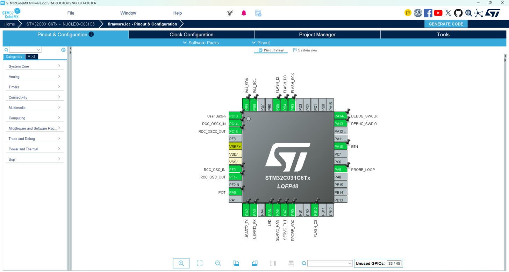

*Рис. 1 — Pinout у STM32CubeMX (firmware.ioc ЛР2): I2C1, SPI1, TIM3, ADC, USART2, CS#, проби*

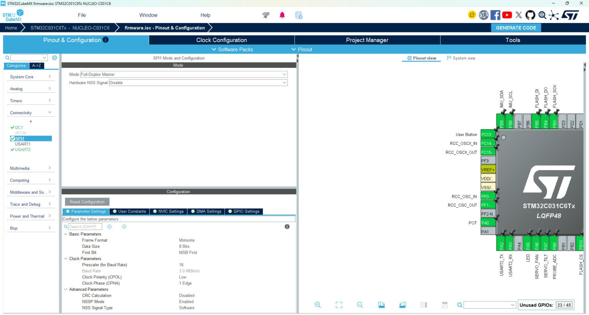

*Рис. 2 — SPI1: Full-Duplex Master, prescaler 16 → 3.0 Мбіт/с, CPOL Low, CPHA 1 Edge, NSS Software*

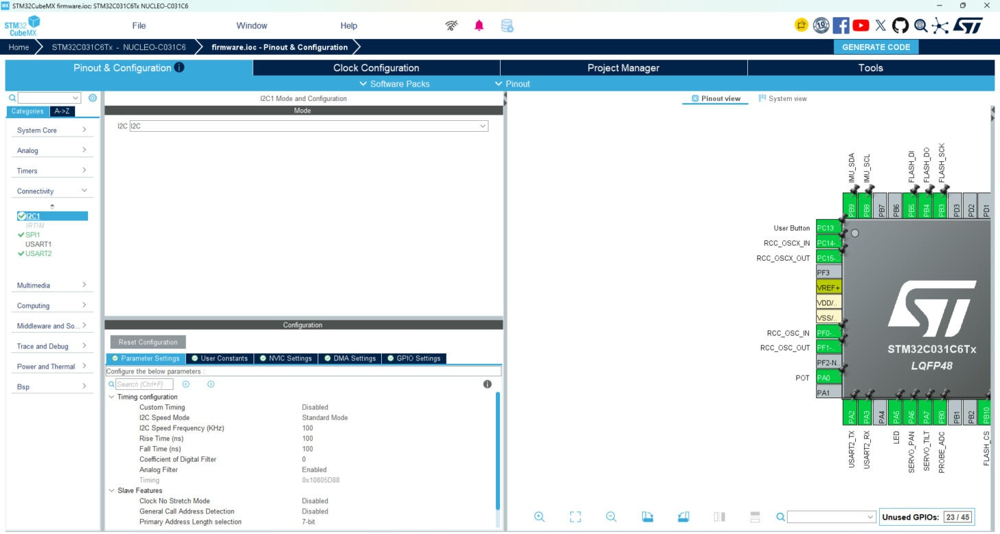

*Рис. 3 — I2C1: Standard mode 100 кГц, t_r = t_f = 100 нс → TIMINGR 0x10805D88*

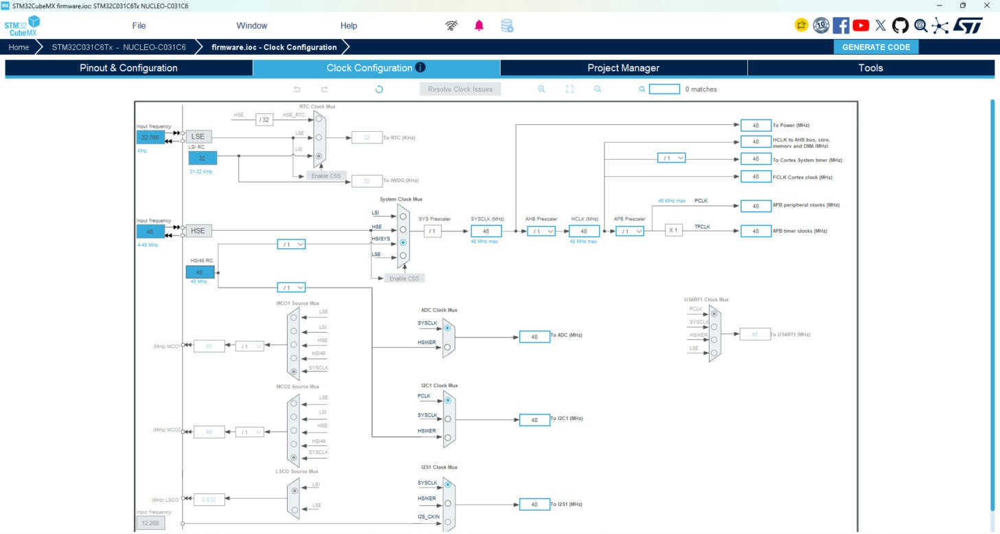

*Рис. 4 — дерево тактування: HSI48 → SYSCLK = HCLK = PCLK = 48 МГц, I2C1CLK = 48 МГц*

## 3.2. Інструкція з підключення (для збирання стенда без автора)

- Живлення вимкнено. Nucleo-C031C6 на макетці; GND Nucleo (CN6) з'єднати з «мінусовою» шиною макетки.
- GY-521 (MPU-6050): VCC → 3V3, GND → GND, SCL → D15, SDA → D14, AD0 → GND (адреса 0x68). XDA/XCL/INT не підключати.
- W25Q64 (модуль): VCC → 3V3, GND → GND, CLK → D3, DO → D5, DI → D6, /CS → D4; /WP і /HOLD → 3V3 (на модулі зазвичай підтягнуто).
- Потенціометр 10 кОм: крайні виводи → 3V3 і GND, середній → A0.
- Серво SG90: оранжевий (PWM) pan → D12, tilt → D11; червоний → +5 В зовнішнього джерела (≥ 1 А); коричневий → GND джерела І GND Nucleo (спільна земля обов'язкова).
- Кнопка MODE: один вивід → D2, другий → GND (pull-up — внутрішній).
- Логічний аналізатор: GND щупа → GND біля МК; канали — за таблицею профілю A або B (pinout.md §1). Проби D10 (ADC) і D8 (контур) — лише для профілю B.
- Перевірка до живлення: мультиметром — немає КЗ 3V3–GND і 5V–GND; між D4 і 3V3 ~10 кОм (pull-up /CS).
- Прошити (make flash / Wokwi ▶), відкрити UART 115200: має бути ST;SUMMARY;all;PASS. Будь-який FAIL — див. рядок пристрою (наприклад who_am_i FAIL → перевірити SDA/SCL і AD0).

# 4. Підключення і перевірка пристроїв (self-test)

Усі пристрої працюють в одній прошивці одночасно. На старті режим самоперевірки виводить у UART рядки формату ST;<пристрій>;<перевірка>;<рівень>;<значення>;<критерій> (розбирає tools/parse_selftest.py, повертає 1 при FAIL). Фрагмент, декодований із лінії TX логічним аналізатором (фінальна прошивка):

```
=== LR2 Motion-Mirroring Teleoperator ===
ST;BEGIN;lab2;INFO;sysclk=48000000;fmt=v1
ST;I2C1;hw_read;WARN;timeout err=0x20 id=0x00;HAL_I2C_Mem_Read ok
ST;I2C1;bus;INFO;soft-i2c;fallback
ST;MPU6050;who_am_i;PASS;0x68;0x68
ST;MPU6050;init;PASS;ok;ok
ST;MPU6050;burst14;PASS;ok;ok
ST;MPU6050;accel_mg;INFO;-500,0,865;
ST;MPU6050;accel_norm_mg;PASS;999;1000+-5%
ST;MPU6050;temp_c;PASS;24.00;15..35
ST;MPU6050;gyro_mdps;PASS;0,0,0;|w|<5dps
ST;W25Q64;jedec_id;PASS;0xEF4017;0xEF4017
ST;W25Q64;sector_erase;PASS;ok;ok
ST;W25Q64;blank_check;PASS;all_FF;all_FF
ST;W25Q64;page_program;PASS;ok;ok
ST;W25Q64;readback;PASS;0/16_diff;0_diff
ST;POT;adc_two_reads;PASS;2050,2050;|d|<=8LSB
ST;SERVO_PAN;ccr_1000;PASS;1000;1000us
ST;SERVO_PAN;ccr_2000;PASS;2000;2000us
ST;BTN;idle_level;PASS;released;released
ST;SUMMARY;all;PASS;pass=15 fail=0 warn=1;
```

| Пристрій | Ідентифікація | Мінімальна ініціалізація | Перевірка правдоподібності | Результат |
|---|---|---|---|---|
| MPU-6050 | WHO_AM_I = 0x68 | PWR_MGMT_1=1, CONFIG=3, SMPLRT_DIV=9, ±2 g, ±250 °/с | \|a\| = 1 g ± 5 %; T у 15…35 °C; \|ω\| < 5 °/с у спокої; pitch = 30° при моделі, нахиленій на 30° | \|a\| = 999 мг, 24.00 °C, ω = 0, pitch = 30 |
| W25Q64 | JEDEC = EF 40 17 | з JEDEC → ємність 8 МБ | стирання → 16 × FF; запис 16 Б → читання збігається побайтово | 0/16 відмінностей |
| Потенціометр | — | ADC 12 біт, 39.5 цикла | два послідовні заміри відрізняються ≤ 8 LSB; 0…4095 → 1000…2000 мкс | 2050, 2050 → 1501 мкс |
| Серво ×2 | — | TIM3 50 Гц | CCR = заданому; на LA ширина 1000/2000 мкс, період 20 мс | 1000.0/2000.0 мкс |
| Кнопка | — | pull-up | у спокої — 1 (released) | released |

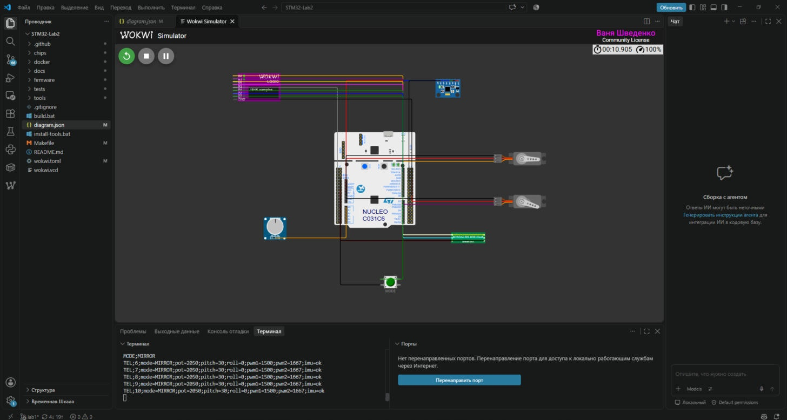

*Рис. 5 — Wokwi: усі пристрої на одній схемі, режим MIRROR (pitch=30 → tilt 1667 мкс)*

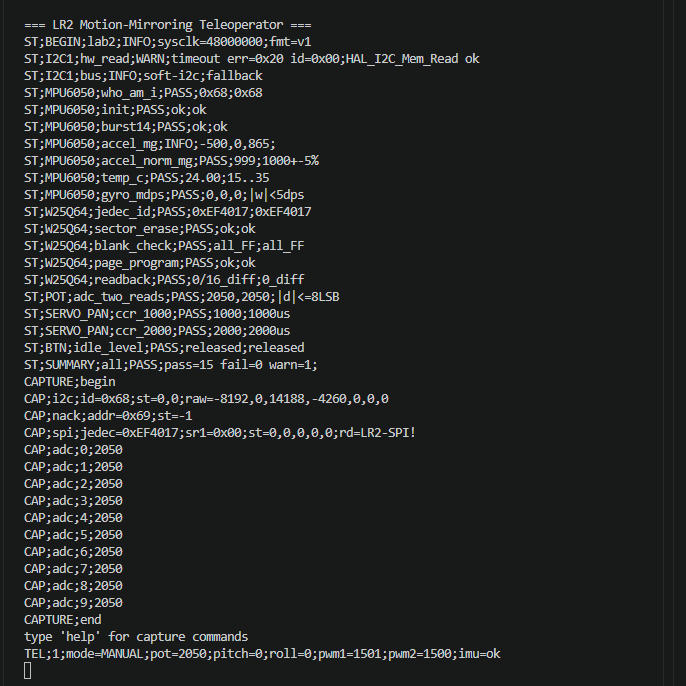

*Рис. 5а — термінал Wokwi (USART2): вивід self-test і сценарію запису*

# 5. Аналіз записів логічного аналізатора

Записи: wokwi-logic-analyzer (8 каналів, VCD з кроком 1 нс). Два профілі підключення щупів (A — шини, B — PWM/проби/кнопка), бо сигналів 11 > 8 каналів. Сценарій запису відтворюваний: після self-test прошивка сама виконує cap i2c / cap nack / cap spi / cap adc (ті самі команди доступні в UART). Вирізки, .sr-сесії PulseView і текстові анотації sigrok-cli — docs/captures/; повний аналіз — docs/captures/analysis.md.

| Інтерфейс | Файл | Дискретизація | Тригер / маркер | Канали |
|---|---|---|---|---|
| I²C | i2c_mpu6050_whoami-burst14.sr | 50 МГц | START (SDA↓ при SCL=1) | SCL, SDA |
| I²C аномалії | i2c_mpu6050_hw-read-stall_anomaly.sr, i2c_mpu6050_nack-0x69_anomaly.sr | 50 МГц | START | SCL, SDA |
| SPI | spi_w25q64_jedec-wren-erase-pp-read.sr | 50 МГц | CS#↓ | SCK, MOSI, MISO, CS# |
| UART | uart_vcp_selftest.sr | 10 МГц | старт-біт | UART_TX |
| PWM | pwm_servo-pan_1000us-2000us.sr | 1 МГц | фронт PWM | PWM_PAN, PWM_TILT |
| ADC | adc_pot_probe-pb0_cap-adc.sr | 10 МГц | PB0↑ | PROBE_ADC, PROBE_LOOP, UART_TX |
| Латентність | mirror_latency_btn-loop-i2c-pwm.sr | 10 МГц | BTN↓ | BTN, PROBE_LOOP, SCL, SDA, PWM_TILT |

Частота дискретизації — щонайменше 4, бажано 8–10 відліків на найкоротший біт: SPI 3 МГц → ≥ 24 МС/с (взято 50); I²C 100 кГц → ≥ 1 МС/с; UART 115200 → ≥ 0.5 МС/с. Верхня межа реального FX2-аналізатора — 24 МС/с, звідси вибір SPI ≤ 3–6 МГц. Без спільної землі аналізатор міряє напругу відносно «чужого» нуля: поріг 1.4 В плаває разом зі зсувом, фронти губляться або подвоюються — навіть якщо «щось видно».

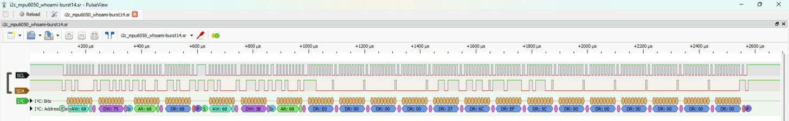

*Рис. 6 — PulseView, декодер I²C: WHO_AM_I і burst 14 байтів (i2c_mpu6050_whoami-burst14.sr)*

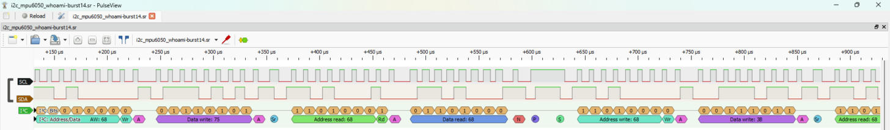

*Рис. 6а — PulseView: S, AW 68, Wr, ACK, DW 75, Sr, AR 68, DR 68, NACK, P — біти кожного байта*

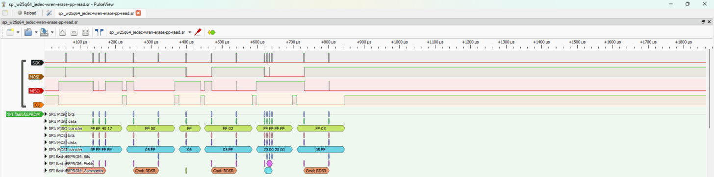

*Рис. 7 — PulseView, стек декодерів SPI + SPI flash/EEPROM: JEDEC (9F → EF 40 17), RDSR, WREN, Sector Erase, BUSY*

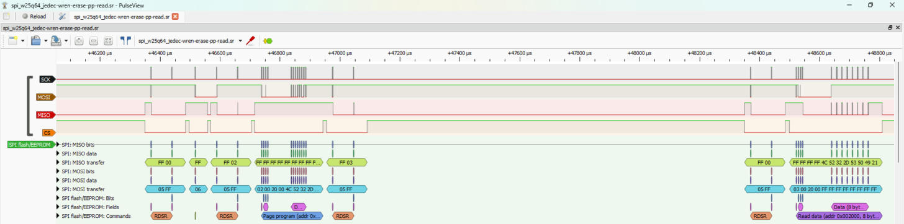

*Рис. 7а — PulseView: WREN → RDSR (WEL) → Page program → RDSR (BUSY/ready) → Read data «LR2-SPI!»*

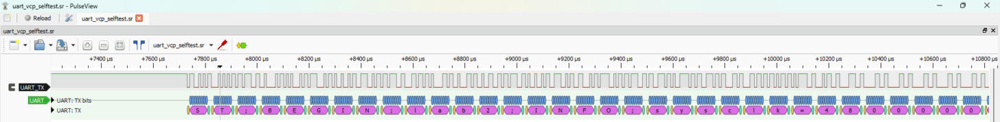

*Рис. 8 — PulseView, декодер UART 115200 8N1 (ASCII): «ST;BEGIN;lab2;INFO;sysclk=48000000…»*

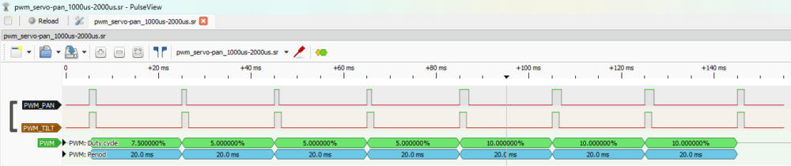

*Рис. 9 — PulseView, декодер PWM: період 20.0 мс, duty 5 % (1000 мкс) і 10 % (2000 мкс)*

## 5.1. I²C — MPU-6050

```
S | 68+W ACK | 75 ACK | Sr | 68+R ACK | 68 NACK | P                                   (WHO_AM_I)
S | 68+W ACK | 3B ACK | Sr | 68+R ACK | E0 00 00 00 37 6C EF 5C 00 00 00 00 00 00 NACK | P
```

Збігається з «Burst Read Sequence» PS-MPU-6000A §9.3: Sr після адреси регістру, ACK після кожного байта крім останнього. Розбір: ACCEL_X = 0xE000 = −8192 → −0.500 g; ACCEL_Z = 0x376C = 14188 → 0.866 g; TEMP = 0xEF5C = −4260 → 24.00 °C; GYRO = 0. |a| = 1.000 g, pitch = 30.0° — саме так нахилено модель у diagram.json. Ці байти — тестовий вектор (tests/la_vectors.h): тест подає їх у драйвер і отримує ті самі raw, що прошивка вивела в UART.

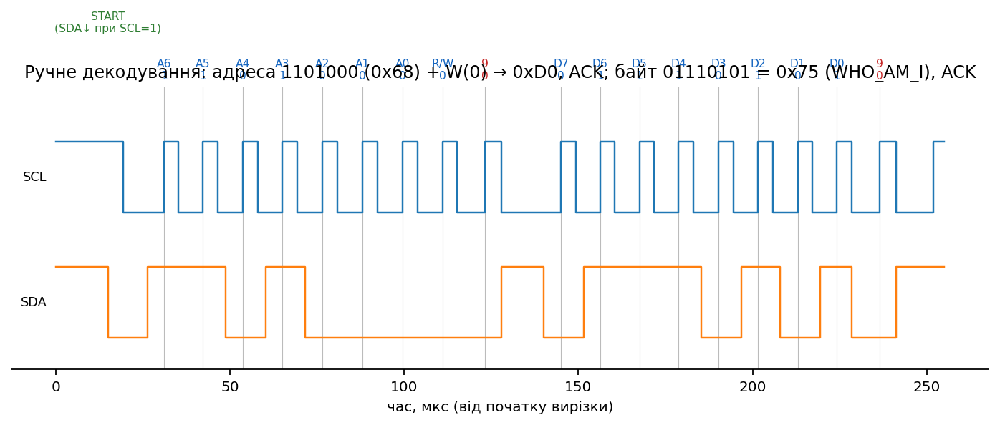

*Рис. 10 — ручне декодування за формою сигналу: START, A6…A0 = 1101000, R/W = 0, ACK, 0x75, ACK*

| Параметр | Розрахунок | Виміряно |
|---|---|---|
| T_SCL HW I2C1 | 10.0 мкс (TIMINGR 0x10805D88) | 10.00 мкс (t_HIGH = t_LOW = 5.0 мкс — модель) |
| T_SCL bit-bang | ≤ 10 мкс | 11.50 мкс (87 кГц) |
| WHO_AM_I (4 Б) | ≈ 414 мкс | 479 мкс |
| Burst 14 Б (+2 Б) | ≈ 1.86 мс | 1.94 мс |
| Пауза між транзакціями | — | 32 мкс |
| PROBE_LOOP↑ → START | — | 62.4 мкс (спершу ADC) |
| Контур MIRROR | ≤ 5 мс (FR-04) | 3.56 мс |

#### Аномалія 1: HAL_I2C_Mem_Read у Wokwi обривається після адреси регістру

На шині: S | 68+W ACK | 75 ACK — і далі нічого (немає Sr, 0xD1, тактів SCL, STOP). HAL повертає HAL_ERROR, HAL_I2C_GetError() = 0x20 (TIMEOUT). Розбіжність між HAL («чекаю RXNE») і шиною (транзакція зупинилась, лінія залишилась «зайнятою»). Дефект моделі STM32C0 у Wokwi (скан IsDeviceReady працює). Self-test фіксує WARN і перемикає вказівник шини на bit-bang реалізацію на тих самих пінах — драйвер не змінюється.

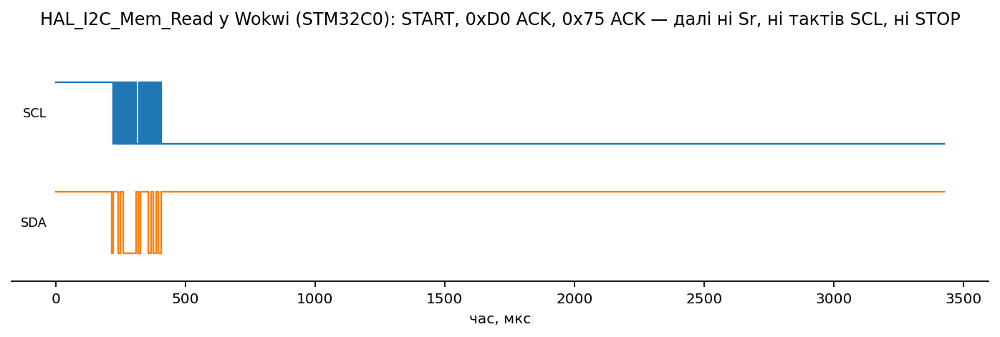

*Рис. 11 — апаратний I²C: фаза читання відсутня*

#### Аномалія 2 (навмисна): неправильна адреса 0x69

cap nack: S | 69+W NACK | P за 123 мкс — на 9-му такті SDA = 1, master одразу видає STOP; драйвер повертає BUS_NACK (−1), UART: CAP;nack;addr=0x69;st=-1. Так виглядала б помилка AD0 = 3V3.

## 5.2. SPI — W25Q64

```
#0  9F FF FF FF  -> FF EF 40 17        JEDEC ID
#2  06 | #3 05 FF -> 02 (WEL)          WRITE ENABLE окремим CS#
#4  20 00 20 00                        SECTOR ERASE 0x002000
#5..#27 05 FF -> 03 (×23, кожні 2 мс)  BUSY; #28 05 FF -> 00 через 45.7 мс
#29 06 | #30 05 -> 02 | #31 02 00 20 00 4C 52 32 2D 53 50 49 21  PAGE PROGRAM "LR2-SPI!"
#32 05 -> 03 | #33 05 -> 00            BUSY < 1.4 мс
#34 03 00 20 00 -> 4C 52 32 2D 53 50 49 21   READ = "LR2-SPI!"
```

Відповідає Instruction Set Table W25Q64JV: опкод, 24-бітна адреса MSB-first, дані; 06h — в окремому інтервалі CS#, запис/стирання стартують по CS#↑, після завершення WEL скидається (SR1 03 → 00). Mode 0: SCK у спокої 0, вибірка по ↑; декодер з cpha=1 дає MISO = DE 80 2F (зсув на біт) — режим підтверджено записом.

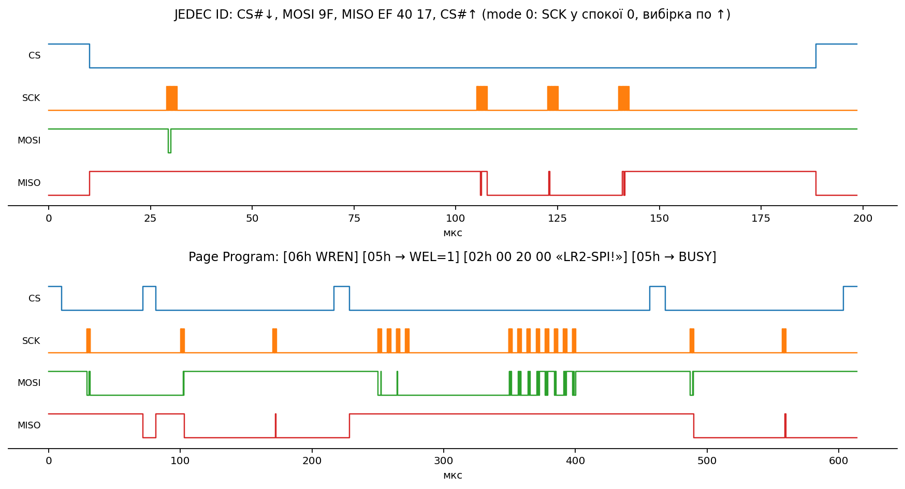

*Рис. 12 — SPI: JEDEC ID і послідовність WREN / RDSR / Page Program / RDSR*

| Параметр | Розрахунок | Виміряно |
|---|---|---|
| f_SCK | 48/16 = 3.0 МГц (333 нс) | 336 нс (2.98 МГц), крок моделі 25 нс |
| Пауза між байтами (tx) | — | 4.58 мкс (до виправлення 60.15 мкс) |
| CS#↓ → SCK / SCK → CS#↑ | ≥ 5 нс (t_SLCH, t_CHSH) | 19 мкс / 44 мкс |
| tSE (модель) | 45 мс тип., ≤ 400 мс | ≈ 45.7 мс |
| tPP (модель) | 0.4 мс тип., ≤ 3 мс | < 1.4 мс (крок опитування) |

## 5.3. UART

115200 8N1, BRR = 417 → 8.688 мкс/біт; найкоротший інтервал між фронтами на записі 8.675 мкс (крок моделі 25 нс). Кадр 10 біт = 86.9 мкс, між початками символів 92.9 мкс (пауза HAL). Self-test до ST;SUMMARY займає 306 мс (включно зі стиранням flash 45 мс і PWM-тестом 120 мс). Текст, декодований sigrok-cli з лінії TX, побайтово збігається з терміналом Wokwi.

## 5.4. PWM

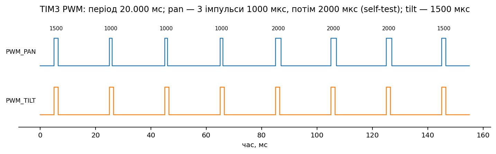

*Рис. 13 — PWM: період 20 мс, 1000 мкс → 2000 мкс (self-test)*

| Параметр | Розрахунок | Виміряно |
|---|---|---|
| Період | (ARR+1) × 1 мкс = 20.000 мс | 20.000 мс |
| Ширина CCR = 1000/1500/2000 | 1000/1500/2000 мкс | 1000.0/1500.0/2000.0 мкс (duty 5/7.5/10 %) |
| Потенціометр 2050 | 1500.6 → 1501 мкс | 1501.0 мкс |
| MIRROR pitch = 30° | 1666.7 → 1667 мкс | 1667.0 мкс |
| Крок 300 °/с за 20 мс | 33 мкс | 1533, 1566, 1599, 1632, 1665, 1667 |

Спостереження: перший імпульс після старту — pan 1505.75 мкс, tilt 1496.25 мкс: канали вмикаються двома викликами HAL_TIM_PWM_Start з інтервалом 9.5 мкс при вже запущеному лічильнику; для серво несуттєво.

## 5.5. ADC і латентність контуру

ADC не має трафіку — момент вимірювання позначає PB0: 1 перед HAL_ADC_Start, 0 після читання. Ширина маркера 38.7 мкс (повний виклик HAL; саме перетворення — 2.17 мкс за розрахунком), період у контурі 20.002 мс. Перехід MANUAL → MIRROR: брязкіт кнопки 2.34 мс (7 фронтів) → одне перемикання (антидребезг 20 мс); перший контур через 16.1 мс; контур 3.56 мс; перший імпульс з новою шириною через 14.9 мс від початку контуру. Латентність IMU → PWM ≤ 23.6 мс (FR-03: < 50 мс, ціль ≤ 25 мс).

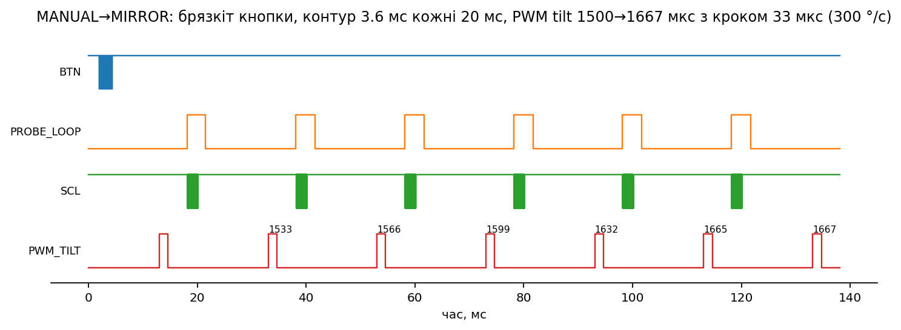

*Рис. 14 — кнопка → контур (PA9) → I²C → PWM tilt*

# 6. Структура проєкту

```
firmware/Core      CubeMX: MX_*_Init, MSP, IRQ → app_main()     (USER CODE: 2 рядки)
firmware/Drivers   HAL v1.4.1 + CMSIS (не редагуються, VERSIONS.md)
firmware/Platform  board.h (усі піни/AF/хендли) + platform.c (порт + шини над HAL)
firmware/Devices   bus.h, mpu6050.c, w25q.c — без HAL
firmware/App       app.c, selftest.c, attitude.c, servo_map.c, cli.c — без HAL
tests/             Unity + doubles;  chips/ модель W25Q64;  tools/ перевірки й аналіз
```

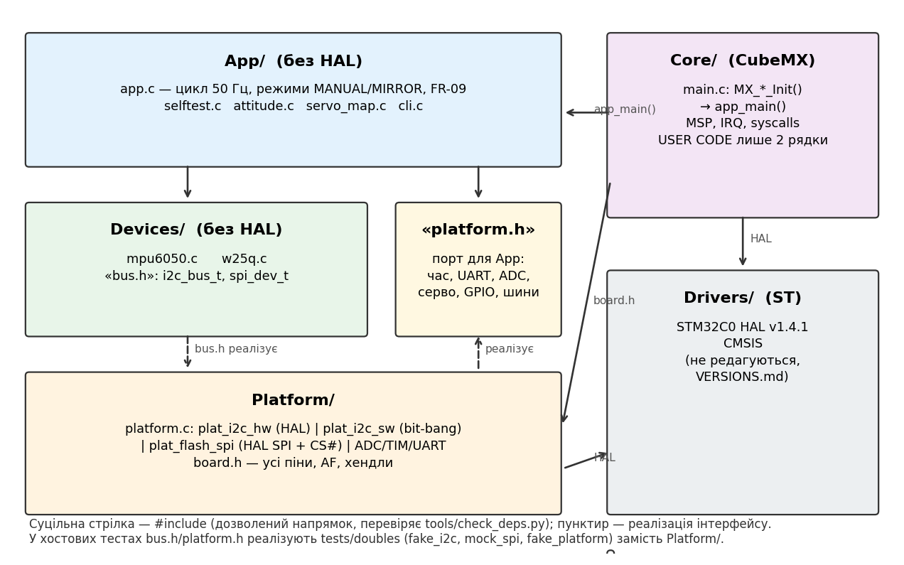

*Рис. 15 — component diagram (lab-report-format §2.7)*

**Правило залежностей:** App → Devices, platform.h; Devices → лише bus.h; Platform → HAL, bus.h; Core → Platform, app.h. Перевіряється не «на честь», а скриптом tools/check_deps.py у make check і CI: кожен #include класифікується за шаром; негативний тест (#include "stm32c0xx_hal.h" у App/servo_map.c) дає «DEPS ERROR App/servo_map.c:1: App -> HAL заборонено», код 1. Друга лінія — хостові тести без -I на HAL.

**Доступ до шини:** драйвер отримує const i2c_bus_t* / spi_dev_t* (вказівники на функції + ctx) у структурі контексту пристрою і не знає про HAL_I2C_Mem_Read. На цілі — plat_i2c_hw()/plat_i2c_sw()/plat_flash_spi(); у тестах — fake_i2c / mock_spi.

**Знання про плату** — лише в Platform/board.h; відповідність board.h ↔ firmware.ioc ↔ diagram.json перевіряє tools/check_pinout.py (15 сигналів, 0 розбіжностей). Код CubeMX: власне — тільки в USER CODE; MX_*_Init беруть константи з board.h; новий пін у .ioc без board.h ловить check_pinout.

**Бібліотеки і збірка:** HAL-модулі увімкнено поштучно з поясненням у hal_conf.h (EXTI вимкнено), у Makefile — явний список HAL_USED. Версії: HAL v1.4.1 (коміт 038bed9f), Unity v2.6.0 (sha256), тулчейн у Dockerfile з версіями apt-пакетів. Власний код: -Wall -Wextra -Werror -Wshadow -Wdouble-promotion; HAL: -isystem і лише -Wno-unused-parameter. Результат — 0 попереджень, 26.9 КБ / 32 КБ flash (-Os -flto), 2.3 КБ / 12 КБ RAM.

```
$ make NATIVE=1 ci
  FLASH: 27284 B / 32 KB (83.26 %)      RAM: 2296 B / 12 KB
check_deps: 73 #include перевірено, порушень: 0
check_pinout: 15 сигналів, розбіжностей: 0
36 Tests 0 Failures
lines: 99.4% (321 out of 323)   functions: 100.0%   branches: 75.7%
```

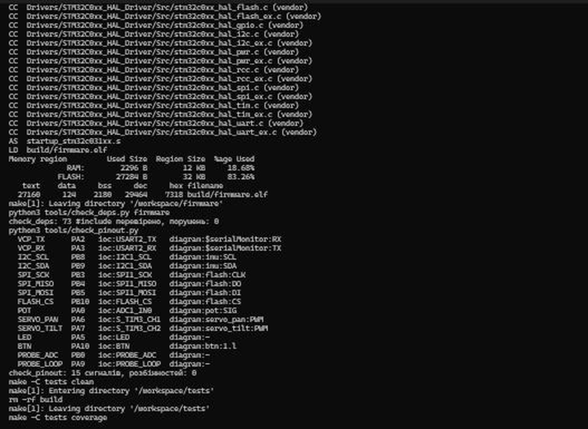

*Рис. 15а — make ci у Docker-образі stm32-build:lab2: збірка прошивки без попереджень*

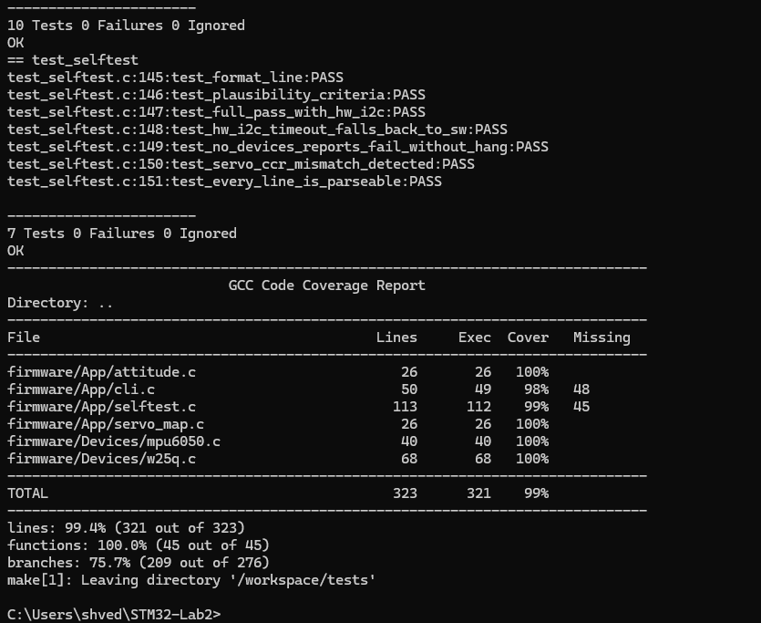

*Рис. 15б — make ci у Docker-образі stm32-build:lab2 (Windows, Docker Desktop): 36 тестів, покриття 99.4 %*

# 7. Тестування

make test збирає тести звичайним gcc (без плати і без HAL). Double-и: fake_i2c (регістровий файл MPU-6050 з інжекцією NACK/timeout), mock_spi (журнал CS#/байтів + черга MISO — для перевірки ПОСЛІДОВНОСТІ команд), fake_platform (stub-и UART/ADC/серво).

| Набір | Тестів | Що перевіряє |
|---|---|---|
| test_mpu6050 | 10 | WHO_AM_I, послідовність init, BADID, NACK (0x69), timeout посеред init, big-endian, приклад з datasheet T = raw/340 + 36.53, чутливість ±2 g/±250 °/с, вектори з LA |
| test_w25q | 9 | JEDEC/ємність, MISO FF/00 → BADID, WREN окремим CS# перед 02h/20h, перевірка WEL, вирівнювання сектора, BUSY + timeout tPP, межа сторінки, адреса MSB-first, CS#↑ при помилці |
| test_app_logic | 10 | кут ↔ мкс, потенціометр, мертва зона ±2°, 300 °/с, кути з accel, фільтр, isqrt, CLI |
| test_selftest | 7 | формат рядків, критерії, повний PASS, fallback HW→SW I²C, відсутні пристрої, CCR, парсинг |

```
журнал mock SPI для page_program(0x012345, {A5,5A}):
"S 06 D S 05 FF D S 02 01 23 45 A5 5A D S 05 FF D w S 05 FF D"   (S = CS#↓, D = CS#↑, w = очікування)
```

**Покриття** (gcovr): Devices/ і App/ (без app.c) — 99.4 % рядків, 100 % функцій, 75.7 % гілок. Поріг CI — 90 % рядків: драйвери й логіка — чистий C, тож поріг досяжний без компромісів, а нижчий пропустив би непокриті гілки помилок. Свідомо не покриваються Core/ (CubeMX), Platform/ (тонкий шар над HAL — перевіряється self-test і LA) і app.c (цикл з таймінгом — перевірено інтеграційно, розд. 5.5).

**Дефект, знайдений тестом:** test_temperature_formula_datasheet: «Expected 2400 Was 2401». Ціле ділення (raw·100)/340 відкидає дріб у бік нуля: для raw = −4260 прошивка друкувала 24.01 °C замість 24.00. Виправлено округленням до найближчого; запис LA до виправлення (raw-profileA-boot.vcd) показує 24.01, після — 24.00.

**CI:** .github/workflows/ci.yml на кожен pull request — make image, make build, make check, make coverage; артефакти — ELF/HEX/MAP і HTML-звіт покриття.

# 8. Журнал проблем

**Проблема 1: стандартний SPI Arduino зайнятий**  
Симптом: D13/D12/D11 (PA5/PA6/PA7) — це SPI1 Arduino, але на них LD4 і серво TIM3 з ЛР1.  
Root cause / фікс: перебір AF у базі CubeMX: друга повна трійка SPI1 на Arduino — PB3/PB4/PB5 (D3/D5/D6, AF0); CS# — PB10 (без AF).  
Коміт: файли: docs/pinout.md, firmware/Platform/board.h, firmware.ioc

**Проблема 2: у Wokwi немає SPI-flash**  
Симптом: у бібліотеці частин Wokwi відсутня W25Q64 — SPI нема з ким перевірити.  
Root cause / фікс: власна модель на Custom Chips API (chips/w25q64.chip.c → wasm, clang). Перша збірка важила 264 КБ: з --import-memory lld записує .bss (256 КБ масив) як нулі в DATA. Пам'ять взято через memory.grow під час init → 2.7 КБ.  
Коміт: файли: chips/w25q64.chip.c, chips/Makefile, wokwi.toml

**Проблема 3: прошивка не влазить у flash**  
Симптом: з -Og і новими драйверами — 30.8 КБ з 32 КБ (94 %); з -flto лінкер: undefined reference to _sbrk.  
Root cause / фікс: root cause: newlib викликає _sbrk з libc.a, яку LTO не бачить, і LTO викидає функцію. Фікс: -Os -flto, а syscalls.c/sysmem.c — з -fno-lto. Результат 26.9 КБ (81 %).  
Коміт: файли: firmware/Makefile (OPT, NO_LTO_OBJ)

**Проблема 4: ld: unrecognized option --no-warn-rwx-segments**  
Симптом: binutils 2.38 (ubuntu 22.04, той самий, що в Docker) не знає ключа з binutils 2.39.  
Root cause / фікс: ключ додається лише якщо `ld --help` його містить (LD_RWX у Makefile).  
Коміт: файли: firmware/Makefile

**Проблема 5: паузи ~60 мкс між байтами SPI**  
Симптом: на LA байт триває 2.4 мкс, а між байтами 56–115 мкс (медіана 60) — ефективно 16 КБ/с замість 375 КБ/с.  
Root cause / фікс: spi_transfer() викликав HAL_SPI_TransmitReceive на кожен байт. Один виклик на буфер (Transmit / TransmitReceive in-place з 0xFF) → медіана 4.6 мкс.  
Коміт: файли: firmware/Platform/platform.c: spi_transfer()

**Проблема 6: bit-bang I²C 14 кГц замість 100**  
Симптом: LA: T_SCL = 71 мкс.  
Root cause / фікс: затримка SW_HALF_LOOPS = 18 підбиралась «на око»; фактично цикл у моделі ~1.9 мкс на ітерацію. Підібрано за LA: SW_HALF_LOOPS = 1 → 11.5 мкс (87 кГц) ≤ 100 кГц.  
Коміт: файли: firmware/Platform/platform.c

**Проблема 7: температура 24.01 °C замість 24.00**  
Симптом: тест з прикладом datasheet падає: Expected 2400 Was 2401.  
Root cause / фікс: ціле ділення відкидає дріб у бік нуля; округлення до найближчого (±170 перед /340).  
Коміт: файли: firmware/Devices/mpu6050.c: mpu6050_temp_cdeg()

**Проблема 8: TIMINGR у коді і в .ioc розійшлися**  
Симптом: у main.c ЛР1 0x20303E5D, у .ioc — 0x10805D88; ручна правка .ioc не діє — CubeMX перераховує TIMINGR, поки Custom Timing = Disabled.  
Root cause / фікс: взято значення CubeMX (t_r = t_f = 100 нс) в board.h — одне джерело; на LA T_SCL = 10.0 мкс в обох випадках.  
Коміт: файли: firmware/Platform/board.h, firmware.ioc

**Проблема 9: тести не перезбирались після зміни драйвера; gcov «overwriting profile data»**  
Симптом: make test показував старий FAIL; gcov сварився на .gcda від попередньої збірки.  
Root cause / фікс: залежності тестів від SRC_<тест> через .SECONDEXPANSION; перед прогоном видаляються *.gcda.  
Коміт: файли: tests/Makefile

**Проблема 10: покриття 0 % у Docker при зелених тестах**  
Симптом: make ci у контейнері: усі 36 тестів PASS, але gcovr показує 0 з 323 рядків.  
Root cause / фікс: у tests/build лишилися бінарники, зібрані у VM: gcc вшиває в них абсолютний шлях для .gcda, тож у контейнері лічильники писались у неіснуючий каталог, а make вважав бінарники актуальними. make coverage тепер спершу виконує make -C tests clean.  
Коміт: файли: Makefile (ціль coverage)

**Проблема 11: запис LA без початку сесії**  
Симптом: у raw-profileA-boot-v2.vcd перший фронт UART на 33 мс замість 0.9 мс.  
Root cause / фікс: Wokwi for VS Code перезапускає симуляцію при зміні firmware.hex (перезбирання під час роботи). Фінальні записи зроблено «з нуля»: зупинка → ▶ → ■ без перезбирань між ними; повнота перевіряється (перший рядок UART на 0.89 мс).  
Коміт: файли: docs/captures/README.md

# 9. Внесок учасників

| Учасник | Напрями | Внесок |
|---|---|---|
| Шведенко Іван Олексійович | 1, 2, 3, 4, 5, 6 | 100 % (одноосібно) |

# 10. Відповіді на контрольні питання (коротко)

**1. Datasheet / RM / UM.** Datasheet МК — які AF має пін у корпусі (PB3 = SPI1_SCK AF0 у LQFP48); RM — як працює блок (SPI1 від PCLK, BR = /2…/256, NSS soft); UM плати — що вже під'єднано (PA5 = LD4, D3 = PB3). Рішення «SPI на D3/D5/D6, CS = D4» потребувало всіх трьох.

**2. Open-drain на I²C.** Будь-який пристрій може лише тягнути лінію в 0; 1 — пасивна (pull-up). Push-pull при ACK або clock stretching дає КЗ виходів 1↔0; на LA — «сходинка» проміжного рівня або 1 там, де slave мав дати ACK.

**3. Номінал pull-up.** R_min = (V_DD − V_OL)/3 мА ≈ 1 кОм; R_max = t_r/(0.8473·C_b) ≈ 5.9 кОм при 200 пФ і 1 мкс. Кілька модулів — опори паралельно (4.7 ∥ 4.7 = 2.35 кОм), зростає струм нуля; третій-четвертий модуль — відпаяти.

**4. SCCB vs I²C.** SCCB не гарантує ACK (9-й біт «don't care») і не підтримує repeated START — HAL_I2C_Mem_Read з Sr та перевіркою ACK отримає NACK/AF; потрібні окремі Transmit + Receive і ігнорування NACK.

**5. CPOL/CPHA.** CPOL — рівень SCK у спокої, CPHA — по якому фронту захоплення. W25Q64 — mode 0 (або 3); на записі SCK у спокої 0, декодер з cpha=0 дає EF 40 17, з cpha=1 — DE 80 2F.

**6. Програмний CS#.** Апаратний NSS master тримає 0 весь час увімкнення SPI; flash потребує окремий інтервал CS# на кожну інструкцію (06h окремо від 02h), запис стартує по CS#↑.

**7. Мінімальна частота дискретизації.** ≥ 4 (краще 8–10) відліки на найкоротший біт: SPI 3 МГц → ≥ 24 МС/с; I²C 100 кГц → ≥ 1 МС/с; UART 115200 → ≥ 0.5 МС/с. Зверху обмежує USB-пропускна FX2 (24 МС/с на 8 каналах).

**8. APB і частоти периферії.** Усі блоки тактуються від PCLK = 48 МГц: UART BRR = 48 МГц/115200 = 417; SPI 48/16 = 3 МГц; TIM3 48 МГц/(47+1) = 1 МГц → ARR 19999 = 20 мс. Зменшення APB вдвічі вдвічі зменшить SPI і змусить змінити BRR/PSC.

**9. Серво не від 3V3.** Струм рушання 360 мА на серво > можливостей LDO/USB, імпульси струму дають шум на VDDA і можуть скинути МК (BOR). Земля спільна — бо PWM-рівень вимірюється відносно землі серво.

**10. Шари.** Core → Platform/App; Platform → HAL; Devices → bus.h; App → Devices + platform.h. Гарантує check_deps.py у CI і відсутність -I на HAL у збірці тестів.

**11. Доступ до шини.** Через i2c_bus_t/spi_dev_t (вказівники на функції + ctx) у структурі пристрою; у тесті — та сама структура з функціями fake_i2c / mock_spi.

**12. Fake vs mock.** Fake — робоча спрощена реалізація зі станом (регістри MPU-6050), перевіряємо стан; mock — записує взаємодію і перевіряє її порядок. Для W25Q64 потрібен саме mock: «06h в окремому CS# перед 02h» — властивість послідовності, а не результату.

**13. Що не покривається.** Core (згенерований), Platform (тонкий шар над HAL — перевіряється self-test + LA), app.c (таймінг головного циклу — інтеграційно у Wokwi).

# 11. Висновок

Усі пристрої PRD (MPU-6050, W25Q64, потенціометр, 2 серво, кнопка, UART) працюють в одній прошивці одночасно; self-test дає 15 PASS / 0 FAIL / 1 WARN (WARN — задокументований дефект моделі I²C у Wokwi з автоматичним обходом). Кожна шина підтверджена записом LA і декодуванням: I²C 100 кГц, SPI mode 0 3 МГц, UART 115200, PWM 20 мс / 1–2 мс; виміряні таймінги збігаються з розрахунком. Записи LA знайшли два дефекти прошивки (побайтовий SPI, повільний bit-bang I²C), тести — третій (округлення температури). Прошивка має шарову структуру з автоматичною перевіркою залежностей, тести з покриттям 99 % і CI; розкладка пінів не потребує змін у ЛР3–ЛР6 (вільні DMA-канали, TIM1/TIM14/16/17, ADC-входи).

# 12. Джерела

1. STMicroelectronics. STM32C031x4/x6 Datasheet, DS13867 rev 4.
2. STMicroelectronics. RM0490 Reference manual STM32C0x1.
3. STMicroelectronics. UM2953 STM32 Nucleo-64 board (MB1717).
4. STMicroelectronics. STM32_open_pin_data (база пінів CubeMX), github.com/STMicroelectronics/STM32_open_pin_data.
5. STMicroelectronics. stm32c0xx-hal-driver v1.4.1 (github.com/STMicroelectronics/stm32c0xx-hal-driver).
6. InvenSense. MPU-6000/MPU-6050 Product Specification PS-MPU-6000A-00 rev 3.4; Register Map RM-MPU-6000A-00 rev 4.2.
7. Winbond. W25Q64JV 3V 64M-bit Serial Flash datasheet.
8. NXP. UM10204 I²C-bus specification and user manual, rev 7.
9. TowerPro. SG90 Micro Servo datasheet.
10. sigrok. PulseView / sigrok-cli / libsigrokdecode — sigrok.org/wiki.
11. Wokwi. Logic Analyzer, Custom Chips API, diagram.json — docs.wokwi.com; wokwi-boards (st-nucleo-c031c6).
12. ThrowTheSwitch. Unity v2.6.0; J. Grenning, Test-Driven Development for Embedded C.
