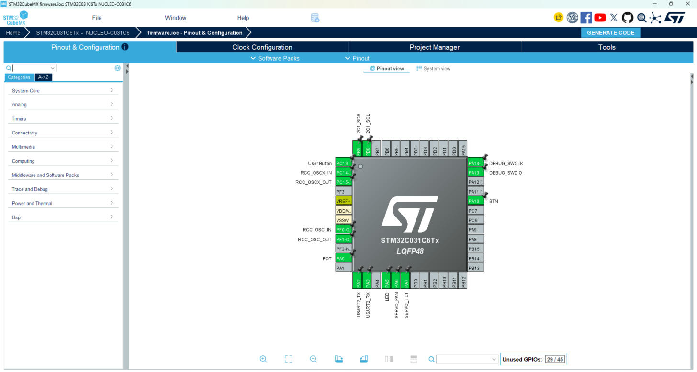
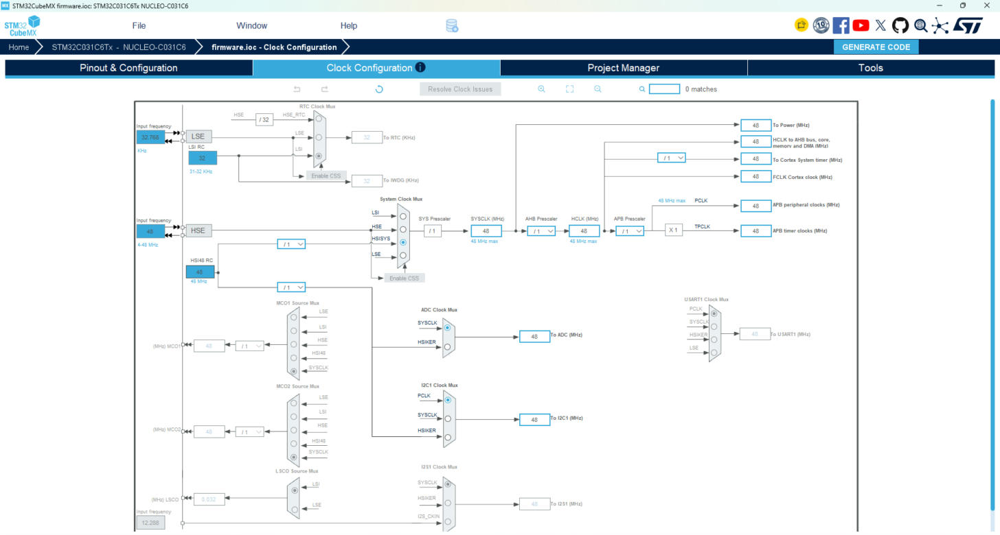
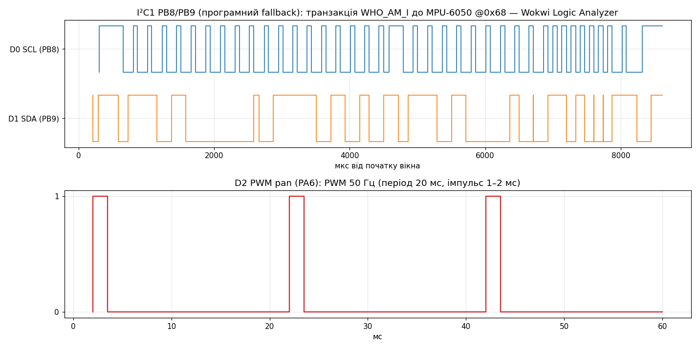

<div class="title-page">

**Міністерство освіти і науки України**
**[Назва університету]**
**[Назва кафедри]**

# Лабораторна робота №1
## Налаштування середовища розробки та bring-up STM32-платформи

з дисципліни «Системне програмування вбудованих систем»

Форма виконання: **B (симулятор Wokwi)**, індивідуально
Тема проєкту: **Motion-Mirroring Teleoperator**

Виконав: студент групи **[група]**, **[курс]** курсу
**[Прізвище Ім'я По батькові]**

Перевірив: **[викладач]**

Київ — 2026

</div>

# 1. Мета лабораторної

На старті я розумів мету так: зібрати середовище, у якому одна команда компілює прошивку, а друга запускає
її на (віртуальній) платі, і побачити в UART перший рядок від мікроконтролера.

Під час роботи мета уточнилася. Головне — **відтворюваність і перевірюваність**. Тулчейн
зафіксовано в Docker-образі (`ubuntu:22.04` + `gcc-arm-none-eabi`), тож проєкт збирається побайтно
однаково на будь-якій машині. Кожен периферійний модуль (USART2, I2C1, ADC1, TIM3, GPIO) під час старту
сам звітує `HAL_OK`, а датчик MPU-6050 ідентифікується за регістром `WHO_AM_I`, а не за «здається, працює».
Окрема частина мети — обґрунтувати набір датчиків для курсового проєкту (PRD) і вести роботу через Git.

# 2. Розподіл обов'язків

Робота виконана індивідуально, тож таблиця не потрібна (п. 4.2 методички).

# 3. Процес виконання

## 3.1. Архітектура рішення

| Шар | Реалізація |
|---|---|
| Тулчейн | `docker/Dockerfile` — ubuntu 22.04, arm-none-eabi-gcc, newlib, srecord |
| Збірка | кореневий `Makefile` (`make image / build / flash / monitor / clean`) → `docker run … make -C firmware all`; `build.bat` для Windows без make |
| Прошивка | `firmware/` — структура CubeMX: `Core/`, `Drivers/` (HAL STM32C0 + CMSIS), `startup_stm32c031xx.s`, `STM32C031C6Tx_FLASH.ld`, `firmware.ioc` |
| Симуляція | `wokwi.toml` → `firmware/build/firmware.elf`; `diagram.json` — Nucleo-C031C6, MPU-6050, потенціометр, 2 серво, кнопка, logic analyzer |
| Документи | `docs/PRD.md`, `docs/hardware-components.md`, `docs/report.md`, `docs/screenshots/` |

Розводка: USART2 PA2/PA3 (VCP), I2C1 PB8/PB9 → MPU-6050 @0x68, ADC1_IN0 PA0 → потенціометр,
TIM3_CH1/CH2 PA6/PA7 → серво pan/tilt (50 Гц, 1–2 мс), PA10 → кнопка MODE, PA5 → LD4.
Деталі й посилання на datasheet — у `docs/hardware-components.md`.

## 3.2. Журнал виконання

| Етап | Що зроблено | Коміт |
|---|---|---|
| 1 | Встановлено Git, VS Code, Docker Desktop, GNU Make, плагін Wokwi (`install-tools.bat`) | `429a85b` |
| 2 | Створено `docker/Dockerfile` і кореневий `Makefile`, зібрано образ `stm32-build` | `429a85b` |
| 3 | З'ясовано, що Wokwi не підтримує F411/F446; обрано Nucleo-C031C6, завантажено HAL STM32C0 і CMSIS | `436cd39` |
| 4 | Скелет CubeMX (`firmware.ioc`): USART2, I2C1, ADC1, TIM3 PWM, GPIO. Згенеровано `MX_*_Init()` | `436cd39` |
| 5 | `_write()` → USART2, перший `hello from STM32`, `tick N` щосекунди | `118b3d7` |
| 6 | I²C-scan + `WHO_AM_I`, PWM на серво, ADC з потенціометра, кнопка режиму | `118b3d7` |
| 7 | `diagram.json`, `wokwi.toml`, перевірка в симуляторі та logic analyzer | `23d77d3` |
| 8 | Документація: `hardware-components.md`, `PRD.md`, цей звіт | `66d72e3, 47c7058, 085538d` |

> Після `git push` зробіть кожен SHA посиланням `https://github.com/<user>/<repo>/commit/<sha>` (`git log --oneline` показує SHA кожного кроку).

## 3.3. Скриншоти

| № | Що показує | Файл |
|---|---|---|
| 1 | CubeMX → Pinout: PA0 ADC1_IN0, PA2/PA3 USART2, PA5 LED, PA6/PA7 TIM3_CH1/CH2, PA10 GPIO_Input, PB8/PB9 I2C1 | `screenshots/cubemx-pinout.png` |
| 2 | CubeMX → Clock Configuration: HSI48, HSIDIV /1, SYSCLK = HCLK = PCLK = 48 МГц | `screenshots/cubemx-clock.png` |
| 3 | Wokwi — схема зі з'єднаннями | `screenshots/wokwi-diagram.png` |
| 4 | Wokwi Serial Monitor — звіт `[ OK ]`, I²C-scan `0x68`, `tick 1, 2, 3 …` | `screenshots/wokwi-uart.png` |
| 5 | Logic analyzer — SCL/SDA під час `HAL_I2C_IsDeviceReady()` і PWM 50 Гц на D12 | `screenshots/logic-i2c-pwm.png` |
| 6 | `make build` у терміналі — розмір `.elf` | `screenshots/make-build.png` |








## 3.4. Очікуваний вивід UART

```
=== hello from STM32 ===
LR1 bring-up | MCU STM32C031C6 | SYSCLK = 48000000 Hz
[ OK ] MX_USART2_UART_Init    -> HAL_OK
[ OK ] MX_I2C1_Init           -> HAL_OK
[ OK ] MX_ADC1_Init           -> HAL_OK
[ OK ] MX_TIM3_Init           -> HAL_OK
[ OK ] HAL_TIM_PWM_Start CH1  -> HAL_OK
[ OK ] HAL_TIM_PWM_Start CH2  -> HAL_OK
I2C1 scan: 0x68  (1 device(s))
MPU-6050 WHO_AM_I (0x75) = 0x68  -> identified
Button on PA10: switch MANUAL (pot) / MIRROR (IMU)

tick 1 | mode=MANUAL pot=2047 pitch=0 roll=0 pwm1=1499 pwm2=1500
tick 2 | mode=MANUAL pot=2047 pitch=0 roll=0 pwm1=1499 pwm2=1500
button pressed -> mode MIRROR
tick 3 | mode=MIRROR pot=2047 pitch=0 roll=0 pwm1=1500 pwm2=1500
```

## 3.5. Проблеми та їх вирішення

### Проблема 1: у Wokwi немає Nucleo-F411RE / F446RE
**Симптом.** Методичка радить F411RE/F446RE, але в `diagram.json` такого типу плати немає. Симулятор
не стартує з ELF, зібраним під Cortex-M4.
**Причина.** Wokwi симулює з лінійки STM32 лише `board-st-nucleo-c031c6`, `board-st-nucleo-l031k6`
і Blue Pill ([Wokwi docs](https://docs.wokwi.com/diagram-format)).
**Рішення.** Ціль — STM32C031C6 (Cortex-M0+, 48 МГц). HAL STM32C0 від ST, `-mcpu=cortex-m0plus` без FPU,
стартап і лінкер для C031. Піни обрано на роз'ємі Arduino (D11/D12/D14/D15/A0), бо на F411RE вони мають ті
самі функції. Перехід на залізо = перегенерація в CubeMX. Коміти: `436cd39`, `23d77d3`.

### Проблема 2: `fatal error: m-profile/cmsis_gcc_m.h: No such file or directory`
**Симптом.** Перша збірка падає на кожному `.c` у `cmsis_gcc.h:1011`.
**Причина.** З `ARM-software/CMSIS_6` взято нові заголовки ядра (CMSIS 6), а HAL STM32C0 очікує CMSIS 5.x
з плоскою структурою `Include/`.
**Рішення.** Узято `Drivers/CMSIS/Include` (CMSIS 5) з офіційного прикладу `wokwi/stm32-hello-wokwi`,
який генерує CubeMX для C031. Урок: версію CMSIS треба брати з того самого STM32Cube FW-пакета, що й HAL.
Коміт: `436cd39`.

### Проблема 3: `implicit declaration of function 'HAL_TIM_MspPostInit'`
**Симптом.** Попередження компілятора в `MX_TIM3_Init()`.
**Причина.** CubeMX оголошує цю функцію в `main.h`, а при ручному перенесенні оголошення загубилося. Без
прототипу C підставляє `int f()`. Це спрацювало б, але так ховаються помилки сигнатур.
**Рішення.** Додано прототип у `Core/Inc/main.h`; збірка без попереджень (`-Wall`). Коміт: `118b3d7`.

### Проблема 4: на Windows немає `make`, а прапорець `--user $(id -u)` ламає `docker run`
**Симптом.** `make build` з методички не працює в PowerShell: немає `make`, `id` не існує, Docker отримує
`--user :`.
**Причина.** Прапорець `--user` потрібен лише на Linux, де bind-mount зберігає UID. Docker Desktop на
Windows сам мапить права через WSL2.
**Рішення.** У кореневому `Makefile` гілка `ifeq ($(OS),Windows_NT)` не додає `--user`. GNU Make
ставиться через winget. Окремо додано `build.bat`, який робить те саме без make. Коміт: `429a85b`.

### Проблема 5: збірка не побайтно відтворювана між машинами
**Симптом.** `firmware.elf`, зібраний у різних каталогах, має різний MD5.
**Причина.** `-g` вшиває в DWARF абсолютний шлях до сорсів.
**Рішення.** Додано `-ffile-prefix-map=$(CURDIR)=.`. Дві чисті збірки поспіль дали однаковий MD5 `firmware.bin`.
Docker-образ гарантує ту саму версію GCC на будь-якій машині. Коміт: `118b3d7`.

### Проблема 6: 32 КБ flash — `printf` + `atan2f` на Cortex-M0+ без FPU
**Симптом.** Перша збірка займала 27 КБ з 32 КБ. Додавання `printf("%f")` переповнило б flash.
**Причина.** На M0+ немає FPU, тож `atan2f/sqrtf` реалізуються програмно (soft-float), а повний newlib
`printf` з float займає ~15 КБ.
**Рішення.** `-specs=nano.specs` (newlib-nano), `--gc-sections`, кути виводяться цілими числами.
Підсумок — 24.5 КБ. Для ЛР2 (Mahony-фільтр) розглянути фіксовану кому або перехід на F446RE з FPU.
Коміт: `118b3d7`.

# 4. Висновок

Що я навчився конкретно:

* **Тактування:** `HAL_RCC_OscConfig` + `HAL_RCC_ClockConfig` будують дерево HSI48 → HSIDIV → SYSCLK →
  AHB/APB. Від цього залежать BRR USART (115200), `Timing` I²C і PSC таймера. Помилка в HSIDIV змінює
  швидкість UART у 4 рази.
* **Alternate functions:** той самий пін PB8 стає I2C1_SCL лише після `GPIO_AF6_I2C1` у
  `HAL_I2C_MspInit`. MSP-шар відокремлює «логіку периферії» від «фізики пінів».
* **printf на МК:** newlib викликає `_write()`, яку я перевизначив на `HAL_UART_Transmit`.
* **Timer-PWM:** PSC = 47 дає 1 тік = 1 мкс, тому CCR дорівнює ширині імпульсу серво в мікросекундах.
* **I²C-bring-up:** `IsDeviceReady` → `WHO_AM_I` → `PWR_MGMT_1` — мінімальна послідовність, яка доводить,
  що шина, адреса й чип живі.
* **Відтворюваність:** Docker фіксує компілятор, `-ffile-prefix-map` прибирає шляхи хоста.

**Куди рухаюся в ЛР2:** драйвер MPU-6050 з гіроскопом, комплементарний → Mahony-фільтр, вимірювання
латентності GPIO-toggle + logic analyzer (FR-03), мертва зона і rate-limit (FR-06), UART CLI.

**Що зробив би інакше:** одразу перевірив би список плат Wokwi перед вибором MCU. Генерував би HAL і
CMSIS одним пакетом через CubeMX, а не збирав із різних репозиторіїв. Ще з першого коміту додав би CI
(GitHub Actions з `make build`).

# 5. Матеріали та посилання

1. STMicroelectronics. *STM32C031x4/x6 Datasheet* (DS13867). https://www.st.com/resource/en/datasheet/stm32c031c6.pdf
2. STMicroelectronics. *RM0490 Reference manual STM32C0x1*. https://www.st.com/resource/en/reference_manual/rm0490-stm32c0x1-advanced-armbased-32bit-mcus-stmicroelectronics.pdf
3. STMicroelectronics. *STM32CubeC0 HAL driver*. https://github.com/STMicroelectronics/stm32c0xx-hal-driver
4. STMicroelectronics. *CMSIS device STM32C0*. https://github.com/STMicroelectronics/cmsis-device-c0
5. STMicroelectronics. *STM32CubeMX*. https://www.st.com/en/development-tools/stm32cubemx.html
6. InvenSense. *MPU-6000/MPU-6050 Product Specification Rev 3.4*. https://invensense.tdk.com/wp-content/uploads/2015/02/MPU-6000-Datasheet1.pdf
7. InvenSense. *MPU-6000/MPU-6050 Register Map Rev 4.2*. https://invensense.tdk.com/wp-content/uploads/2015/02/MPU-6000-Register-Map1.pdf
8. TowerPro. *SG90 Micro Servo datasheet*. http://www.ee.ic.ac.uk/pcheung/teaching/DE1_EE/stores/sg90_datasheet.pdf
9. Wokwi. *diagram.json File Format*. https://docs.wokwi.com/diagram-format
10. Wokwi. *STM32 Nucleo-64 C031C6*. https://docs.wokwi.com/parts/board-st-nucleo-c031c6
11. Wokwi. *stm32-hello-wokwi* (приклад HAL-проєкту). https://github.com/wokwi/stm32-hello-wokwi
12. Wokwi. *VS Code extension — Getting started*. https://docs.wokwi.com/vscode/getting-started
13. xPack. *GNU Arm Embedded GCC 13.2.1*. https://github.com/xpack-dev-tools/arm-none-eabi-gcc-xpack
14. Docker. *docker run reference*. https://docs.docker.com/reference/cli/docker/container/run/

# 6. Відеозвіт

Посилання на відео (Google Drive, 2–3 хв): **[вставити посилання]**

Зміст: представлення (ім'я, курс, група) → `make build` → запуск Wokwi → лог `[ OK ]` і `tick` →
поворот потенціометра (серво pan рухається) → натискання MODE → нахил MPU-6050 (серво повторюють) →
logic analyzer.

# 7. PRD

Див. окремий файл `docs/PRD.md`: ідея, 11 функціональних вимог, обґрунтування датчиків з альтернативами, план тестування.
