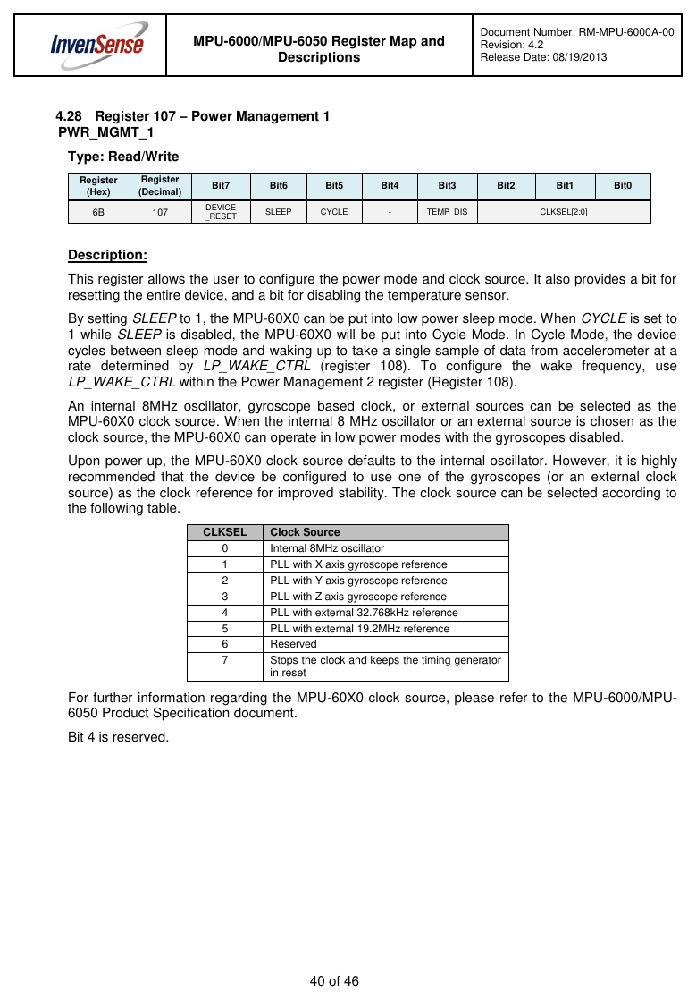
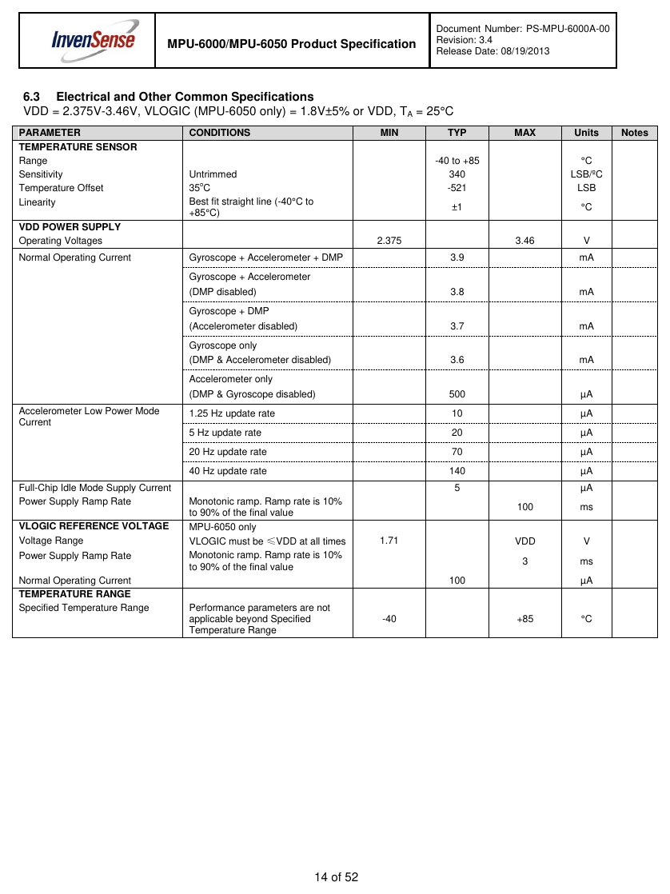
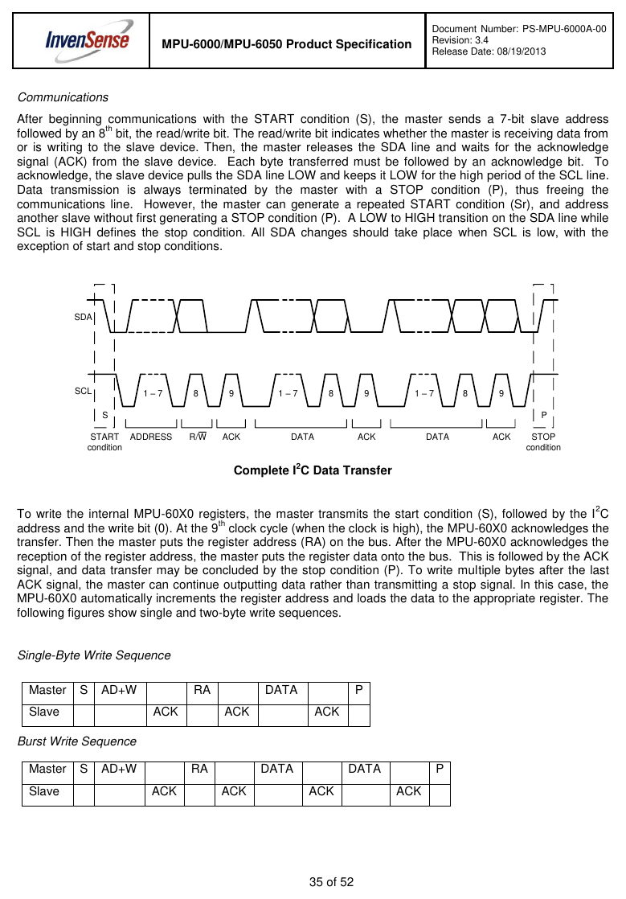
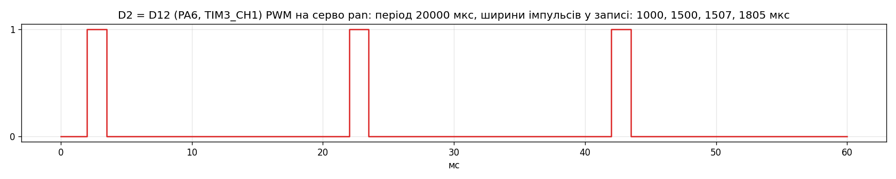

Міністерство освіти і науки України  
Національний технічний університет України  
«Київський політехнічний інститут імені Ігоря Сікорського»  

Факультет інформатики та обчислювальної техніки  

Кафедра обчислювальної техніки  

**Лабораторна робота №1**  
з дисципліни «Системне програмування»  
«Налаштування середовища розробки та bring-up STM32-платформи»  

Виконав:  
студент 4 курсу  
групи ІО-32  
Шведенко І.  

Перевірив:  
Гордієнко Н.Ю.  

Київ — 2026  

---

### Лабораторна робота №1

### Налаштування середовища розробки та bring-up STM32-платформи

**Мета:** розібратися з повним циклом embedded-розробки під STM32: зібрати відтворюваний тулчейн (Docker + arm-none-eabi-gcc + HAL), запустити прошивку в симуляторі Wokwi і отримати першу відповідь по UART. На практиці перевірити роботу I²C, ADC, PWM, GPIO і виводу в UART, ідентифікувати датчик за регістром, а не «на око», і оформити вимоги до власного проєкту у вигляді PRD.

На старті я розумів мету як «побачити hello у терміналі». Під час роботи вона уточнилася: головне — щоб кожен крок можна було перевірити. Кожна ініціалізація звітує HAL-статус, MPU-6050 підтверджується читанням WHO_AM_I, а сигнали на шинах — записом логічного аналізатора.

**Репозиторій:** https://github.com/ivan32232323/STM32-Lab1

**PRD:** https://github.com/ivan32232323/STM32-Lab1/blob/lab1/docs/PRD.md

**Pull request (здача):** https://github.com/ivan32232323/STM32-Lab1/pulls

**Відео:** [посилання на відео буде додано]

**Форма виконання:** B (симулятор Wokwi). **Тема проєкту:** №6 «Motion-Mirroring Teleoperator» — дзеркалення руху руки на сервоприводах.

# 2. Розподіл обов'язків

Робота виконана одноосібно, таблиця не потрібна.

# 3. Процес виконання

## 3.1. Журнал роботи

| Дата | Що зроблено | Коміт |
|---|---|---|
| 06.11 | Встановлено VS Code + Wokwi, Git, Docker Desktop (install-tools.bat); Dockerfile з arm-none-eabi-gcc, кореневий Makefile | [429a85b](https://github.com/ivan32232323/STM32-Lab1/commit/429a85b) |
| 06.11 | Обрано Nucleo-C031C6 (єдина Nucleo-64 у Wokwi), скелет CubeMX-проєкту: .ioc, HAL STM32C0, CMSIS, startup, linker | [436cd39](https://github.com/ivan32232323/STM32-Lab1/commit/436cd39) |
| 06.11 | printf через USART2, ініціалізація I2C1/ADC1/TIM3/GPIO з перевіркою HAL_OK, I²C-скан, WHO_AM_I, tick N | [118b3d7](https://github.com/ivan32232323/STM32-Lab1/commit/118b3d7) |
| 06.11 | diagram.json: MPU-6050, потенціометр, 2 серво, кнопка, logic analyzer; wokwi.toml | [23d77d3](https://github.com/ivan32232323/STM32-Lab1/commit/23d77d3) |
| 06.11 | docs/hardware-components.md з посиланнями на сторінки datasheet; docs/PRD.md | [66d72e3](https://github.com/ivan32232323/STM32-Lab1/commit/66d72e3), [47c7058](https://github.com/ivan32232323/STM32-Lab1/commit/47c7058) |
| 06.11 | Перший запуск у Wokwi, діагностика читання MPU-6050 через wokwi.vcd, обхід (soft-I²C fallback) | [86c7d85](https://github.com/ivan32232323/STM32-Lab1/commit/86c7d85) |
| 06.11 | Скриншоти, декодування I²C і PWM з VCD, вирізки datasheet, звіт | [acc949b](https://github.com/ivan32232323/STM32-Lab1/commit/acc949b), [e992338](https://github.com/ivan32232323/STM32-Lab1/commit/e992338) |

## 3.2. Docker-тулчейн

Образ `stm32-build` на базі ubuntu:22.04 з gcc-arm-none-eabi, newlib і srecord (`docker/Dockerfile`). Збірка запускається командою `make build`: кореневий `Makefile` викликає `docker run … make -C firmware all`. На Windows прапорець `--user $(id -u):$(id -g)` не передається (Docker Desktop сам мапить права), для систем без make є `build.bat`.

```
make image   # один раз: docker build -t stm32-build docker/
make build   # docker run --rm -v $(PWD):/workspace -w /workspace stm32-build make -C firmware all
make flash   # для Wokwi: свіжий ELF + перезапуск симулятора
make monitor # для Wokwi: Serial Monitor у VS Code
```

```
LD  build/firmware.elf
   text    data     bss     dec     hex filename
  25612     112    2320   28044    6d8c build/firmware.elf
```

Прошивка займає 25,6 КБ flash з 32 КБ і 2,4 КБ RAM з 12 КБ. Дві чисті збірки поспіль дають однаковий MD5 `firmware.bin` (`-ffile-prefix-map` прибирає шляхи хоста з DWARF).

Коміт: https://github.com/ivan32232323/STM32-Lab1/commit/429a85b

## 3.3. STM32CubeMX

| Периферія | Параметри | Виводи |
|---|---|---|
| USART2 | 115200 8N1, ST-Link VCP | PA2 (TX) / PA3 (RX), AF1 |
| I2C1 | Standard Mode 100 kHz, Timing = 0x20303E5D | PB8 (SCL, D15) / PB9 (SDA, D14), AF6 |
| TIM3 CH1, CH2 | PWM 50 Hz: Prescaler = 47 (1 МГц), Period = 19999 (20 мс) | PA6 (D12) / PA7 (D11), AF1 |
| ADC1 | IN0, 12 біт, sampling 39.5 cycles | PA0 (A0) |
| GPIO | кнопка MODE: input pull-up; LD4: output | PA10 (D2) / PA5 (D13) |

SYSCLK = HCLK = PCLK = 48 MHz від HSI48 (HSIDIV /1). Проєкт має структуру CubeMX з тулчейном Makefile, файл `firmware/firmware.ioc` збережено в репозиторії.

[Скриншоти CubeMX Pinout і Clock Configuration буде додано.]

Коміт: https://github.com/ivan32232323/STM32-Lab1/commit/436cd39

## 3.4. Перший запуск у Wokwi

printf перенаправлено в USART2 через `_write()` (`Core/Src/syscalls.c`). Налаштовано `wokwi.toml` (`firmware/build/firmware.hex`, `elf`) і `diagram.json`. Під час старту прошивка звітує статус кожної ініціалізації:

```
=== hello from STM32 ===
LR1 bring-up | MCU STM32C031C6 | SYSCLK = 48000000 Hz
[ OK ] MX_USART2_UART_Init    -> HAL_OK
[ OK ] MX_I2C1_Init           -> HAL_OK
[ OK ] MX_ADC1_Init           -> HAL_OK
[ OK ] MX_TIM3_Init           -> HAL_OK
[ OK ] HAL_TIM_PWM_Start CH1  -> HAL_OK
[ OK ] HAL_TIM_PWM_Start CH2  -> HAL_OK
I2C1 scan: 0x68  (1 device(s))
HW I2C1 read: st=1 err=0x20 id=0x00 -> fallback to bit-bang I2C
soft-I2C read: st=0 id=0x68
MPU-6050 WHO_AM_I (0x75) = 0x68  [soft-I2C] -> identified
tick 1 | mode=MANUAL pot=0 pitch=0 roll=0 pwm1=1000 pwm2=1500
tick 2 | ...
```

Коміти: https://github.com/ivan32232323/STM32-Lab1/commit/118b3d7, https://github.com/ivan32232323/STM32-Lab1/commit/23d77d3

## 3.5. Компоненти і datasheets

У `docs/hardware-components.md` для кожного компонента вказано інтерфейс, адресу, ключові регістри, живлення і номер сторінки datasheet. Нижче — сторінки, на які спирається bring-up.


*1. InvenSense. MPU-6000/MPU-6050 Register Map and Descriptions, RM-MPU-6000A-00, rev 4.2, с. 45 — WHO_AM_I (0x75) = 0x68.*



*2. Там само, с. 40 — PWR_MGMT_1 (0x6B): після ввімкнення SLEEP = 1, пишемо 0x00.*


*3. Там само, с. 29 — ACCEL_XOUT_H…ACCEL_ZOUT_L (0x3B–0x40), ±2 g = 16384 LSB/g.*


*4. InvenSense. MPU-6000/MPU-6050 Product Specification, PS-MPU-6000A-00, rev 3.4, с. 15 — I²C 100/400 кГц, адреса 1101000 (AD0 = 0).*



*5. Там само, с. 14 — VDD 2.375–3.46 В, струм 3.8 мА: живлення від 3V3 Nucleo достатньо.*



*6. Там само, с. 35 — протокол I²C: S, адреса + R/W, ACK, Sr, STOP.*

| Компонент | Інтерфейс | Ключові параметри | Джерело |
|---|---|---|---|
| STM32C031C6 | USART2, I2C1, ADC1, TIM3 | AF1 USART2 PA2/PA3, AF6 I2C1 PB8/PB9, AF1 TIM3 PA6/PA7 | DS13867 rev 4, «Alternate function mapping» |
| Nucleo-C031C6 | ST-Link VCP | VCP = USART2 PA2/PA3, LD4 = PA5 | UM2953, розд. 6.9–6.10 |
| MPU-6050 | I²C @0x68 | WHO_AM_I 0x75, PWR_MGMT_1 0x6B, ACCEL 0x3B | RM-MPU-6000A с. 29, 40, 45; PS-MPU-6000A с. 14–15 |
| SG90 ×2 | PWM 50 Гц | 1.0 мс = −90°, 1.5 мс = 0°, 2.0 мс = +90°; 4.8–6 В | TowerPro SG90 datasheet |
| Потенціометр 10 кОм | ADC | 0…3.3 В → 0…4095 | — |
| Кнопка | GPIO | pull-up, активний 0, антидребезг 20 мс | — |

Коміт: https://github.com/ivan32232323/STM32-Lab1/commit/66d72e3

## 3.6. Сенсори і перевірка шин

До `diagram.json` додано MPU-6050 (I²C), потенціометр (ADC), два серво SG90 (PWM), кнопку MODE (GPIO) і логічний аналізатор на D15/SCL, D14/SDA, D12/PWM, PA2/UART TX. Кнопка перемикає режим MANUAL → MIRROR. У режимі MIRROR кути нахилу з акселерометра перераховуються в ширину імпульсу серво: 1500 + кут · 500 / 90 мкс.


*Wokwi: режим MIRROR. accel Y = 1.45 g → roll = atan2(1.45, 1) = 55° → pwm1 = 1805 мкс; accel X < 0 → pitch = 31° → pwm2 = 1672 мкс. Обидва серво повернуті.*

Декодована транзакція WHO_AM_I. Запис Wokwi Logic Analyzer (`wokwi.vcd`) розібрано скриптом `tools/vcd_plot.py`: `S | 0xD0 ACK | 0x75 ACK | Sr | 0xD1 ACK | 0x68 NACK | P`. Це стандартне читання регістра (PS-MPU-6000A с. 35–36), датчик повернув 0x68. NACK на останньому байті ставить майстер, так і має бути.


*I²C: читання WHO_AM_I з MPU-6050 (SCL = PB8, SDA = PB9).*



*PWM на D12 (TIM3_CH1): період 20 000 мкс, у записі зустрічаються імпульси 1000, 1500 і 1805 мкс — MANUAL, нейтраль і MIRROR 55°.*

Коміти: https://github.com/ivan32232323/STM32-Lab1/commit/86c7d85, https://github.com/ivan32232323/STM32-Lab1/commit/e992338

## 3.7. Проблеми та їх вирішення

### Проблема 1: У Wokwi немає Nucleo-F411RE / F446RE

**Симптом:** у diagram.json немає такого типу плати, ELF під Cortex-M4 не стартує.

**Причина:** Wokwi симулює з лінійки STM32 лише Nucleo-C031C6, Nucleo-L031K6 і Blue Pill.

**Фікс:** ціль — STM32C031C6 (Cortex-M0+, 48 МГц): HAL STM32C0, `-mcpu=cortex-m0plus` без FPU, стартап і лінкер для C031. Піни взято на роз'ємі Arduino (D11/D12/D14/D15/A0), бо на F411RE вони мають ті самі функції.

Коміт: https://github.com/ivan32232323/STM32-Lab1/commit/436cd39

### Проблема 2: fatal error: m-profile/cmsis_gcc_m.h: No such file or directory

**Симптом:** перша збірка падає на кожному .c у cmsis_gcc.h:1011.

**Причина:** заголовки ядра взято з CMSIS 6, а HAL STM32C0 очікує CMSIS 5.x з плоскою структурою Include/.

**Фікс:** взято Drivers/CMSIS/Include з того самого STM32Cube FW-пакета, що й HAL (приклад wokwi/stm32-hello-wokwi).

Коміт: https://github.com/ivan32232323/STM32-Lab1/commit/436cd39

### Проблема 3: implicit declaration of function 'HAL_TIM_MspPostInit'

**Симптом:** попередження компілятора в MX_TIM3_Init().

**Причина:** CubeMX оголошує цю функцію в main.h, а при перенесенні оголошення загубилося.

**Фікс:** додано прототип у Core/Inc/main.h, збірка з -Wall без попереджень.

Коміт: https://github.com/ivan32232323/STM32-Lab1/commit/118b3d7

### Проблема 4: На Windows немає make, а --user $(id -u) ламає docker run

**Симптом:** `make build` з методички не працює в PowerShell: Docker отримує `--user :`.

**Причина:** `--user` потрібен лише на Linux; Docker Desktop на Windows мапить права через WSL2.

**Фікс:** у Makefile гілка `ifeq ($(OS),Windows_NT)` без `--user`, Make ставиться через winget, додано build.bat.

Коміт: https://github.com/ivan32232323/STM32-Lab1/commit/429a85b

### Проблема 5: VS Code «Опубликовать Branch» нічого не робить

**Симптом:** після натискання не з'являється вибір private/public, у журналі Git немає спроби push.

**Причина:** у репозиторію ще не було remote, а діалог створення репозиторію GitHub-розширення не відкрився.

**Фікс:** репозиторій створено на github.com, `git remote add origin …`, після чого публікація гілок main і lab1 пройшла.

Коміт: — (зміна лише в налаштуваннях .git/config)

### Проблема 6: Прошивка займає 27 КБ з 32 КБ flash

**Симптом:** printf + atan2f/sqrtf на Cortex-M0+ без FPU.

**Причина:** soft-float бібліотека і повний newlib printf.

**Фікс:** `-specs=nano.specs`, `--gc-sections`, кути виводяться цілими. Для fusion-фільтра у ЛР2 — фіксована кома або F446RE з FPU.

Коміт: https://github.com/ivan32232323/STM32-Lab1/commit/118b3d7

### Проблема 7: HAL_I2C_Mem_Read до MPU-6050 у Wokwi повертає HAL_TIMEOUT

**Симптом:** I²C-скан бачить 0x68, але WHO_AM_I = 0x00, `HAL_I2C_GetError() = 0x20` (TIMEOUT). Роздільні Master_Transmit + Master_Receive дають те саме.

**Причина:** розбір wokwi.vcd: фаза запису (0xD0 ACK, 0x75 ACK) проходить, але після адреси читання 0xD1 ACK модель I2C STM32C0 у Wokwi не генерує тактів SCL для байта даних. Це обмеження симулятора, а не схеми.

**Фікс:** апаратний I2C1 лишився для ініціалізації і скану; якщо апаратне читання не вдається, вмикається програмний I²C на тих самих пінах через HAL_GPIO. Перша версія теж читала 0x00: модель не повертає рівень лінії для open-drain виходу, тому SDA на час читання перемикається у вхід з pull-up. Після цього WHO_AM_I = 0x68. На реальній Nucleo fallback не вмикається.

Коміт: https://github.com/ivan32232323/STM32-Lab1/commit/86c7d85

# 4. Висновок

Навчився:

- збирати прошивку STM32 в ізольованому Docker-середовищі і робити збірку відтворюваною (однаковий MD5 між збірками);
- будувати дерево тактування HSI48 → SYSCLK → AHB/APB і розуміти, як від нього залежать BRR USART, Timing I²C і PSC таймера;
- прив'язувати периферію до пінів через alternate functions (AF1 USART2/TIM3, AF6 I2C1) і MSP-шар HAL;
- перенаправляти printf у UART через _write() з newlib;
- налаштовувати таймер так, щоб CCR дорівнював ширині імпульсу серво в мікросекундах (PSC = 47, ARR = 19999);
- перевіряти I²C-пристрій за адресою та ідентифікаційним регістром і доводити, де саме ламається транзакція, за записом логічного аналізатора.

Куди рухаюся в ЛР2: драйвер MPU-6050 з гіроскопом, комплементарний → Mahony-фільтр, вимірювання латентності «рух IMU → оновлення PWM» через GPIO-toggle і логічний аналізатор (FR-03, < 50 мс), мертва зона і rate-limit (FR-06), UART CLI.

Що зробив би інакше: одразу перевірив би список плат і периферії, яку підтримує Wokwi, перед вибором MCU; генерував би HAL і CMSIS одним пакетом через CubeMX; з першого коміту додав би CI з `make build`.

# 5. Матеріали та посилання

1. InvenSense. MPU-6000/MPU-6050 Register Map and Descriptions, RM-MPU-6000A-00, rev 4.2. 46 с.
2. InvenSense. MPU-6000/MPU-6050 Product Specification, PS-MPU-6000A-00, rev 3.4, 19.08.2013. 52 с.
3. STMicroelectronics. STM32C031x4/x6 Datasheet, DS13867, rev 4. https://www.st.com/en/microcontrollers-microprocessors/stm32c031c6.html
4. STMicroelectronics. RM0490 Reference manual: STM32C0x1. https://www.st.com/en/microcontrollers-microprocessors/stm32c031c6.html#documentation
5. STMicroelectronics. STM32 Nucleo-64 boards (MB1717), user manual UM2953. https://www.st.com/resource/en/user_manual/um2953-stm32-nucleo64-board-mb1717-stmicroelectronics.pdf
6. STMicroelectronics. STM32CubeC0 HAL driver. https://github.com/STMicroelectronics/stm32c0xx-hal-driver
7. STMicroelectronics. CMSIS device STM32C0. https://github.com/STMicroelectronics/cmsis-device-c0
8. TowerPro. SG90 Micro Servo datasheet. http://www.ee.ic.ac.uk/pcheung/teaching/DE1_EE/stores/sg90_datasheet.pdf
9. Wokwi. diagram.json File Format. https://docs.wokwi.com/diagram-format
10. Wokwi. STM32 Nucleo-64 C031C6 (simulation features). https://docs.wokwi.com/parts/board-st-nucleo-c031c6
11. Wokwi. stm32-hello-wokwi — приклад HAL-проєкту. https://github.com/wokwi/stm32-hello-wokwi
12. Wokwi. VS Code extension — Getting started. https://docs.wokwi.com/vscode/getting-started
13. Docker. docker run reference. https://docs.docker.com/reference/cli/docker/container/run/
